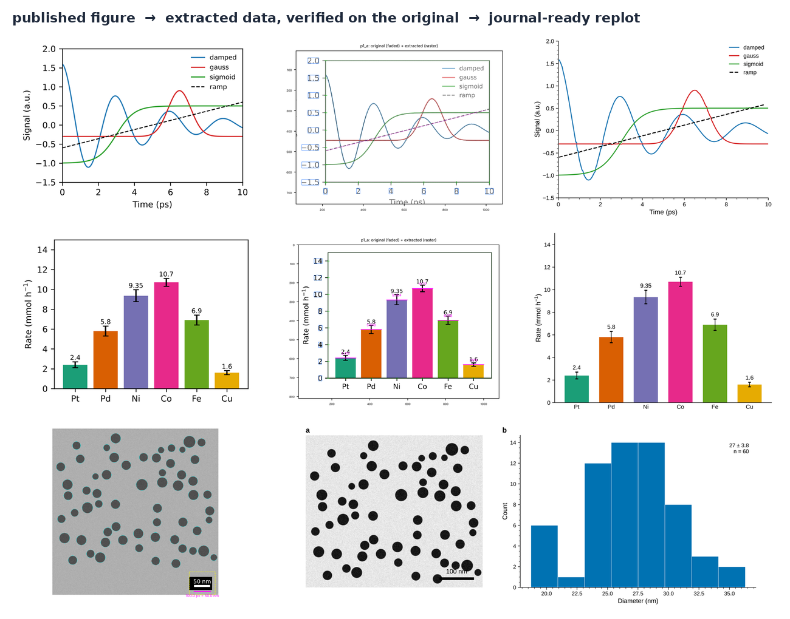
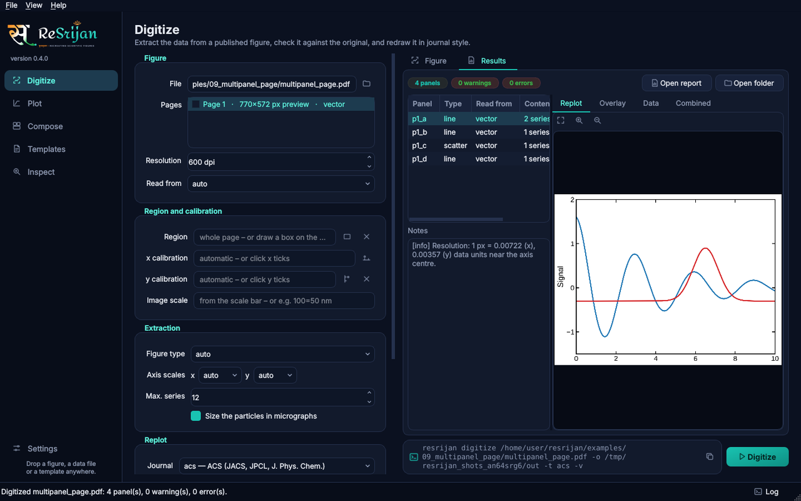

<p align="center">
  <picture>
    <source media="(prefers-color-scheme: dark)" srcset="https://raw.githubusercontent.com/rbiswasgroup/resrijan/main/docs/images/resrijan-logo-dark-calligraphic.svg">
    
  </picture>
</p>

<p align="center"><b>Digitise, analyse, fit and redraw scientific figures in journal style.</b><br>Data from published figures – corrected, analysed, fitted – and new figures in any journal's style.</p>

<p align="center">
<a href="https://github.com/rbiswasgroup/resrijan/actions/workflows/ci.yml"></a>
<a href="https://pypi.org/project/resrijan/"></a>


<a href="https://github.com/rbiswasgroup/resrijan/blob/main/LICENSE"></a>
</p>

ReSrijan reads a figure from a paper (PDF, EPS, PS, SVG, PNG, JPG or TIFF) and finds every panel in it. It reads the axes, then extracts the data from each panel: curves, symbols with error bars, bar charts, heat maps, 2D spectra, contour plots, stacked spectra, and micrographs with their scale bars, insets and drawn measurements. It checks the result for inconsistencies and writes CSV files, an HTML report that overlays the extracted data on the original figure, and a clean replot in the style of Nature Chemistry, ACS, APS, JCP, Science, PNAS or RSC. Replots come as editable vector files (PDF, SVG, EPS) or as bitmaps (PNG, TIFF).

The extracted data – or your own measurements – can then be corrected by hand over the original figure, analysed (baseline, smoothing, unit conversion, peak fitting with errors, deconvolution of overlapping bands) and fitted with any model, with bounds and a fit range: time constants from correlation functions, diffusion coefficients from mean square displacements, activation energies and more.

It is also a figure engine on its own: give it your data and it builds a multi-panel figure, arranges the panels automatically and labels them in the journal's style. Every step works from the command line and from a graphical interface, on Windows, Linux and macOS.

Everything runs locally. No uploads, no web service.



## Features

* **Exact vector extraction.** In PDF, EPS, PS and SVG files, curves, symbols, bars and tick labels are read from the drawing commands, so there is no pixel rounding at all.
* **Careful bitmap extraction.**
  * Tick marks are located to a fraction of a pixel, and labels are read by OCR with RANSAC calibration, so a misread label is rejected rather than trusted.
  * Lines are separated by colour in CIELAB, with anti-aliasing taken into account.
  * Sharp peaks are traced along their flanks, and symbols are found by template matching.
* **All the common figure types.** Line and scatter plots (with error bars, legend names or labels placed next to the points), bar charts (categories, error bars, printed values), heat maps and 2D-IR spectra (colour-bar inversion), filled and line contours (2D NMR), stacked spectra without a y axis, and inset plots.
* **Image figures.** Micrographs and photographs at their native resolution: scale bars (drawn by the figure or burnt in by the microscope), particle sizing, HRTEM lattice fringes checked against printed d-spacings, magnified insets located in their parent image, and time-lapse rows whose drawn arrows and lines become data series.
* **Anomaly report.** Each extraction lists:
  * misread labels, uneven tick spacing (possible axis breaks), and reversed or logarithmic axes;
  * clipped data, occluded traces and spikes;
  * colour-map saturation;
  * bars whose printed value disagrees with the drawn height, and stray shapes;
  * JPEG artefacts and the data resolution of each axis.
* **Correct by hand.** In the GUI, drag, add or delete points over the original figure, split and merge series, and save the edited data with a log of every change.
* **Analysis.** Baseline (ALS, polynomial), smoothing, normalisation, unit conversion (nm, µm, cm⁻¹, eV, THz), peak fitting (Gaussian, Lorentzian, pseudo-Voigt) with standard errors, deconvolution of overlapping bands (second-derivative start positions, constraints, area fractions), and areas.
* **Curve fitting.** Any formula or a preset (multi-exponential and stretched-exponential decays, MSD, power law, Arrhenius …) with starting values, bounds, fixed constants, a fit range and derived quantities with propagated errors – e.g. time constants from correlation functions and D from the MSD.
* **Journal templates** as plain YAML files: `natchem`, `acs`, `aps`, `jcp`, `science`, `pnas`, `rsc` and `presentation`, or your own.
* **Automatic multi-panel layout** with panel letters in the journal's style. Text stays editable in Illustrator and Inkscape.

## Install on Windows 10/11

1. Download **ReSrijan-0.6.0-Setup.exe** (185 MB) from the [latest release](https://github.com/rbiswasgroup/resrijan/releases/latest).
2. Optional – check the download in PowerShell: `Get-FileHash .\ReSrijan-0.6.0-Setup.exe` must print
   `EFB331FF3934891560D4C78170CED4CA48958314D16F2BBF1BF8AFA10DDCE496`.
3. Run it. Windows may show "Windows protected your PC", because the installer is not code-signed yet: click **More info → Run anyway**. No administrator rights are needed, and everything is included (Python, the GUI, Tesseract OCR, Ghostscript).
4. Start **ReSrijan** from the Start menu or the desktop. **ReSrijan command prompt** gives you the `resrijan` command line; right-click a figure → **Open with → ReSrijan** opens it directly.

**If ReSrijan does not open**, a message box names the problem and the log is in `%LOCALAPPDATA%\ReSrijan\logs\gui.log` (Start menu → **ReSrijan - logs**). Start menu → **ReSrijan - troubleshoot** checks every part of the installation (`resrijan doctor`) and starts the GUI with a console that shows any error. If nothing appears at all, see whether Windows Security blocked the program: **Virus & threat protection → Protection history**, and on Windows 11 **App & browser control → Smart App Control**.

**Slower than on Linux.** Digitising and starting ReSrijan take longer on Windows; see [Limitations](#limitations) for why and for the antivirus exclusion that speeds it up.

Uninstall from **Settings → Apps → ReSrijan**; your journal templates (`%APPDATA%\resrijan\templates`) are kept.

ReSrijan also runs on Windows from Python (`pip install "resrijan[gui]"`), but then Tesseract and Ghostscript must be installed separately – the installer is simpler.

## Install on Linux (Ubuntu 22.04 / 24.04)

ReSrijan needs three system tools (Tesseract for OCR, Ghostscript for EPS/PS, librsvg for SVG) and Python 3.10 or newer:

```bash
sudo apt install tesseract-ocr ghostscript librsvg2-bin fonts-liberation
python3 -m venv ~/resrijan-env && . ~/resrijan-env/bin/activate
pip install resrijan
resrijan templates
```

From source (to run the tutorials and tests):

```bash
git clone https://github.com/rbiswasgroup/resrijan.git
cd resrijan
./install.sh          # the apt packages above, then a private venv with ReSrijan installed
```

Other Linux distributions work with the same packages.

## Install on macOS

> **Not yet tested on a Mac.** These steps use only packages that exist for macOS (Intel and Apple Silicon); please report how they work for you.

ReSrijan runs on macOS through Python. Install the three tools it uses (Tesseract for OCR, Ghostscript for EPS/PS, librsvg for SVG) and Python with [Homebrew](https://brew.sh), then ReSrijan in its own environment. Do not use `install.sh` on a Mac: it is written for Ubuntu.

1. Install the tools and Python:

   ```bash
   brew install tesseract ghostscript librsvg python@3.12
   ```

2. Create an environment for ReSrijan and install it with the graphical interface:

   ```bash
   python3.12 -m venv ~/resrijan-env
   ~/resrijan-env/bin/pip install "resrijan[gui]"
   ```

3. Check the installation – it should end with "Everything needed works":

   ```bash
   ~/resrijan-env/bin/resrijan doctor
   ```

4. Start the graphical interface, or use the command line:

   ```bash
   ~/resrijan-env/bin/resrijan gui
   ```

To type just `resrijan`, run `echo 'export PATH="$HOME/resrijan-env/bin:$PATH"' >> ~/.zshrc` once and open a new Terminal window. To update later: `~/resrijan-env/bin/pip install --upgrade "resrijan[gui]"`.

## Graphical interface

Prefer a window? `pip install "resrijan[gui]"`, then run `resrijan gui`. Every command and option is there, in a dark interface:
- draw the region and click axis ticks on a preview;
- browse the replots, overlays and data;
- correct the extracted points by hand, over the original figure;
- plot your own data with a live preview, styled to your taste (line styles, markers, legend, fonts, labels and arrows);
- analyse spectra: baseline, peak fitting and deconvolution with errors, areas;
- fit any formula with bounds and a fit range (time constants, diffusion coefficients …);
- compose multi-panel figures, import and edit journal templates;
- save the whole session as a project and reopen it later.

Each page shows the equivalent `resrijan` command, ready to copy into a script. See [tutorial 18](https://github.com/rbiswasgroup/resrijan/blob/main/docs/tutorials/18-gui.md).



## Quick start

```bash
# extract the data from a figure and replot it for Nature Chemistry
resrijan digitize figure.pdf -t natchem

# one page and region of a paper, listing every note
resrijan digitize paper.pdf --page 5 --region 0.08,0.10,0.52,0.40 -v

# a micrograph (the scale bar is found automatically)
resrijan digitize tem.tif --type micrograph

# plot your own data with a journal template
resrijan plot data.csv -x t_ps -y c1,c2 --yscale log --xlabel "t (ps)" --ylabel "C(t)" -t acs

# baseline, automatic peak fitting with errors, and an area
resrijan analyze spectrum.csv --baseline als --peaks auto --area 1400:1500

# stretched-exponential fit of correlation functions; D from the linear part of an MSD
resrijan fit correlation.csv -m kww --xscale log
resrijan fit msd.csv -m msd3d --range 20:200

# a multi-panel figure from a YAML description
resrijan compose figure.yaml
```

Open `<file>_resrijan/<file>_report.html` after each `digitize` run to check the extraction against the original.

## Tutorials

The tutorials in [`docs/tutorials/`](https://github.com/rbiswasgroup/resrijan/blob/main/docs/tutorials/README.md) each use a file from [`examples/`](https://github.com/rbiswasgroup/resrijan/tree/main/examples) and show the real output:

| | | |
|---|---|---|
| [0 · Getting started](https://github.com/rbiswasgroup/resrijan/blob/main/docs/tutorials/00-getting-started.md) | [6 · Heat maps & 2D-IR](https://github.com/rbiswasgroup/resrijan/blob/main/docs/tutorials/06-heatmaps-2dir.md) | [12 · Plot your own data](https://github.com/rbiswasgroup/resrijan/blob/main/docs/tutorials/12-plot-your-data.md) |
| [1 · Line plots](https://github.com/rbiswasgroup/resrijan/blob/main/docs/tutorials/01-line-plots.md) | [7 · Filled contours](https://github.com/rbiswasgroup/resrijan/blob/main/docs/tutorials/07-contour-plots.md) | [13 · Compose multi-panel figures](https://github.com/rbiswasgroup/resrijan/blob/main/docs/tutorials/13-compose-figures.md) |
| [2 · Spectra & reversed axes](https://github.com/rbiswasgroup/resrijan/blob/main/docs/tutorials/02-spectra.md) | [8 · Micrographs](https://github.com/rbiswasgroup/resrijan/blob/main/docs/tutorials/08-micrographs.md) | [14 · Journal templates](https://github.com/rbiswasgroup/resrijan/blob/main/docs/tutorials/14-journal-templates.md) |
| [3 · Log axes](https://github.com/rbiswasgroup/resrijan/blob/main/docs/tutorials/03-log-axes.md) | [9 · Multi-panel pages](https://github.com/rbiswasgroup/resrijan/blob/main/docs/tutorials/09-multipanel-pages.md) | [15 · Python API](https://github.com/rbiswasgroup/resrijan/blob/main/docs/tutorials/15-python-api.md) |
| [4 · Scatter & error bars](https://github.com/rbiswasgroup/resrijan/blob/main/docs/tutorials/04-scatter-errorbars.md) | [10 · SVG, EPS, PS](https://github.com/rbiswasgroup/resrijan/blob/main/docs/tutorials/10-svg-eps-ps.md) | [16 · Image figures](https://github.com/rbiswasgroup/resrijan/blob/main/docs/tutorials/16-image-figures.md) |
| [5 · Bar charts](https://github.com/rbiswasgroup/resrijan/blob/main/docs/tutorials/05-bar-charts.md) | [11 · When automatic reading fails](https://github.com/rbiswasgroup/resrijan/blob/main/docs/tutorials/11-manual-calibration.md) | [17 · Tricky axes](https://github.com/rbiswasgroup/resrijan/blob/main/docs/tutorials/17-tricky-axes.md) |
| [20 · Curve fitting](https://github.com/rbiswasgroup/resrijan/blob/main/docs/tutorials/20-curve-fitting.md) | [19 · Analyse spectra and curves](https://github.com/rbiswasgroup/resrijan/blob/main/docs/tutorials/19-analysis.md) | [18 · Graphical interface](https://github.com/rbiswasgroup/resrijan/blob/main/docs/tutorials/18-gui.md) |

## Accuracy

`validation/make_testset.py` draws figures of every type from known data and saves each in several formats. `validation/run_validation.py` digitises them end to end and compares the result with the truth. Errors are a percentage of the axis range, so 0.1 % on a 0–10 axis is 0.01:

| figure type | vector input (PDF/EPS/PS/SVG) | bitmap input (PNG/JPG, 110–300 dpi) |
|---|---|---|
| line plots, spectra, log axes | 0.011–0.042 % RMS | 0.02–0.32 % RMS |
| scatter with error bars | exact | 0.13–0.26 % RMS, all points found |
| bar charts | exact | ≤ 0.19 %, categories read |
| heat maps / 2D-IR | 0.28–0.30 % RMS (embedded image) | 0.43–0.75 % RMS |
| filled contours | 98.8 % of pixels in the exact level | 95.6 % exact, 100 % within ±1 level |
| micrograph scale bar | — | exact; mean particle diameter within 0.1 % |

The full table is in [`validation/RESULTS.md`](https://github.com/rbiswasgroup/resrijan/blob/main/validation/RESULTS.md). To run it yourself:

```bash
python validation/make_testset.py testset && python validation/run_validation.py testset results
```

## Supported inputs

| kind | formats |
|---|---|
| vector | PDF, EPS, EPSI, EPSF, PS, SVG, SVGZ |
| bitmap | PNG, JPG/JPEG, TIFF (8/16-bit, float), BMP, GIF, WebP |
| data for plotting | CSV, TSV or whitespace tables, grid CSV, NPZ, images, YAML figure specs |

## Limitations

* **Hollow symbols in bitmaps.** Line-and-symbol series whose hollow symbols are partly hidden under another series can be traced as a line in bitmaps. The vector versions are exact.
* **Unsupported chart types.** Plots without axis lines (ggplot-style grey panels) need a manual calibration, and horizontal or stacked bars are not supported yet.
* **Axis titles.** In bitmaps, titles containing maths are read unreliably by OCR. Set them with `--xlabel` and `--ylabel`. (In vector files they are read exactly, with sub- and superscripts.)
* **Image figures in bitmaps.** An inset that touches its parent image without a gap cannot be separated from it, and very short drawn arrows (about 15 px or less) are not found.
* **Scans.** Rotated or warped scans should be straightened first.
* **No GPU, little parallelism.** No part of ReSrijan uses the graphics card. NumPy/SciPy (OpenBLAS) and OpenCV use several CPU cores inside their own operations, but pages, panels and fits are processed one after another.
* **Windows is slower than Linux.** On the same files, digitising and start-up take longer on Windows, for these reasons:
  * Microsoft Defender scans every file the program opens, and the bundled runtime has thousands of them.
  * The first start compiles about 2,000 Python modules and builds Matplotlib's font list (once per installation).
  * Windows is slower at starting programs such as Tesseract and Ghostscript, and at reading many small files.

  **Workaround:** exclude ReSrijan from antivirus scanning (optional; only if you trust the download):
  1. **Windows Security → Virus & threat protection → Manage settings** (under *Virus & threat protection settings*).
  2. Scroll down to **Exclusions → Add or remove exclusions**.
  3. Choose **Add an exclusion → Folder** and paste `%LOCALAPPDATA%\Programs\ReSrijan`.

  As administrator in PowerShell: `Add-MpPreference -ExclusionPath "$env:LOCALAPPDATA\Programs\ReSrijan"`. No *Exclusions* option usually means one of these:
  * another antivirus manages the PC: add the exclusion there instead;
  * your institution manages Windows Security: ask IT;
  * you have no administrator rights.

  ReSrijan works without the exclusion, only more slowly.

## Why "ReSrijan"?

*Srijan* (सृजन) is the Sanskrit and Hindi word for **creation**. *ReSrijan* is re-creation, or in Sanskrit **पुनःसृजन** (*punaḥ-sṛjana*), creating anew.

That is what the package does. It takes a figure that has been flattened into a PDF page or an image, reads its axes, text and graphics, recovers the underlying data, and recreates the figure as clean, editable, publication-ready vector graphics.

The logo carries the same idea. The letter **स**, the first letter of सृजन, dissolves into pixels on one side, the published image, and is re-drawn as a single solid stroke ending in a data point. Its saffron, white and green, and the lotus over the *j*, are a nod to the project's Indian roots.

## Contributing

Bug reports with a sample figure are the most useful contribution, together with the HTML report from the run. See [CONTRIBUTING.md](https://github.com/rbiswasgroup/resrijan/blob/main/CONTRIBUTING.md).

## Citing

If ReSrijan helps your work, please cite it. The Linux, macOS and Python version (`pip install resrijan`, `./install.sh`) and the Windows installer are the same program built from the same source, so they share one citation; give the version you used, and the platform if you like.

> Biswas, R. (2026). *ReSrijan: digitise, analyse, fit and redraw scientific figures in journal style* (Version 0.6.0) [Computer software]. Indian Institute of Technology Tirupati. https://github.com/rbiswasgroup/resrijan

```bibtex
@software{biswas_resrijan_2026,
  author    = {Biswas, Rajib},
  title     = {{ReSrijan}: digitise, analyse, fit and redraw scientific figures
               in journal style},
  year      = {2026},
  version   = {0.6.0},
  publisher = {Indian Institute of Technology Tirupati},
  url       = {https://github.com/rbiswasgroup/resrijan},
  note      = {Linux/macOS: Python package (PyPI: resrijan); Windows 10/11: ReSrijan-0.6.0-Setup.exe}
}
```

In a methods section, for example: *"Data were extracted from the published figures with ReSrijan 0.6.0 (Windows 10 installer) [ref]; the extracted points were checked against the original figures in the overlay images it produces."* For the Linux or Python version write *"ReSrijan 0.6.0 (Python package, Ubuntu 24.04)"*.

The same details are in [CITATION.cff](https://github.com/rbiswasgroup/resrijan/blob/main/CITATION.cff) (GitHub's **Cite this repository** button gives APA and BibTeX).

## Licence

ReSrijan is released under the **GNU Affero General Public License v3.0 or later** ([LICENSE](https://github.com/rbiswasgroup/resrijan/blob/main/LICENSE)), because two of its core dependencies, PyMuPDF and Ghostscript, are AGPL-licensed. Other dependencies: NumPy, SciPy, Matplotlib, OpenCV, scikit-image, scikit-learn, Pillow, pytesseract/Tesseract and PyYAML.

**Use responsibly.** Extracted data are a reconstruction. Cite the original source of any data you digitise, and respect the publisher's terms for reusing figures.
