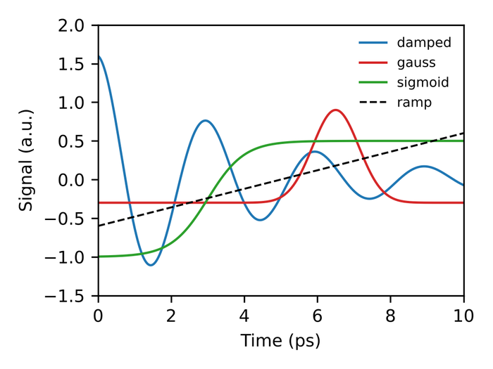
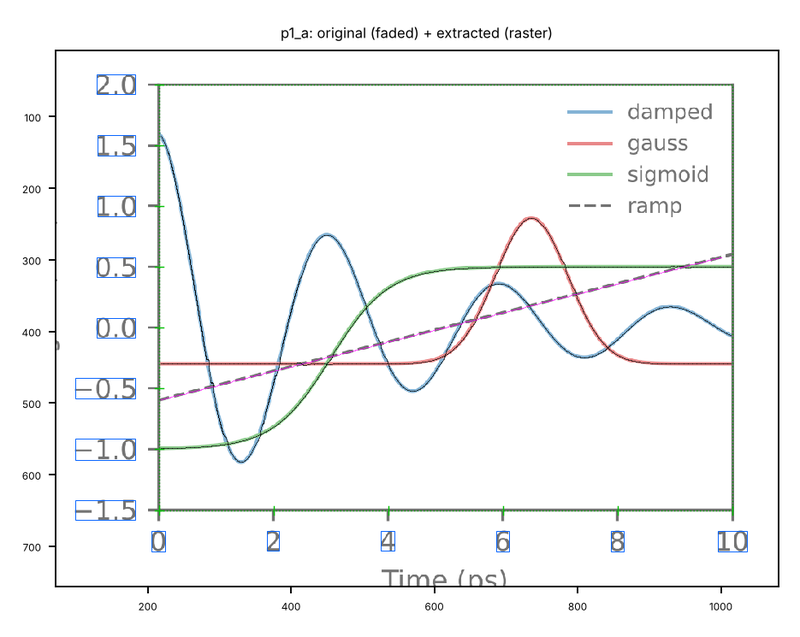
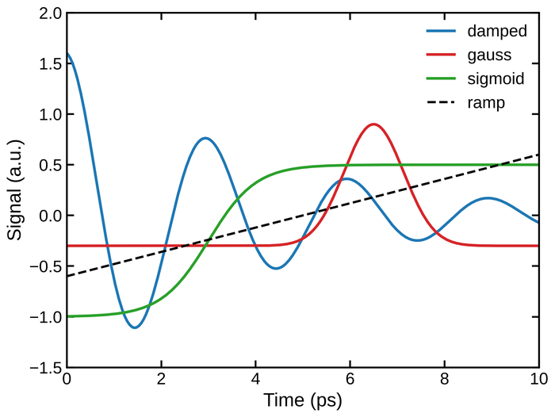

# 1 · Line plots

**Example:** [`examples/01_line_plot/`](../../examples/01_line_plot). The figure has four series: three coloured lines and a black dashed line, a legend, and a full frame. It is saved twice: as a 300-dpi PNG (`line_multi.png`) and as a vector PDF (`line_multi.pdf`).



## From a bitmap (PNG / JPG / TIFF)

```bash
cd examples/01_line_plot
resrijan digitize line_multi.png -o output/png -v
```

```text
  p1_a     line        raster          4 series               warnings: 0  errors: 0
      [info] Resolution: 1 px = 0.0125 (x), 0.00589 (y) data units near the axis centre.
```

The verification overlay shows the original faded, with the extracted points on top. Green marks are the detected tick marks and blue boxes are the tick labels that were read:



What happened:

1. **Axes.** The frame was found, the tick marks were located to a fraction of a pixel, and each tick label was read by OCR. A straight-line fit through the labels (RANSAC) turns pixels into data values.
2. **Series.** The colours were separated in CIELAB. Anti-aliased edge pixels are assigned to the series whose colour they are a lighter mix of, so lines that touch or cross stay apart.
3. **Names.** The legend text was read and matched to the colour of the line sample drawn beside it, so the series are called `damped`, `gauss`, `sigmoid` and `ramp`, not `series_1…4`.
4. **Dashed line.** The regular gaps were recognised, and the dashes are joined in the data.

The data (`output/png/line_multi_p1_a_data.csv`):

```text
series,x,y,yerr_minus,yerr_plus,kind,source
damped,0.04054575416,1.576368982,nan,nan,line,raster
damped,0.04671758037,1.57122007,nan,nan,line,raster
...
```

Accuracy against the true curves: 0.11 % of the axis range RMS, and 0.18 % at the 95th percentile.

## From a vector PDF: exact coordinates

```bash
resrijan digitize line_multi.pdf -o output/pdf -t acs -v
```

```text
  p1_a     line        vector          4 series               warnings: 0  errors: 0
```

`vector` means the numbers come straight from the drawing commands in the file: no pixels, no OCR (tick labels are real text). The error drops to 0.026 % RMS. Whenever the publisher's PDF has the figure as vector graphics, use the PDF.

A vector line is stored as its exact vertices, with straight segments between them. The CSV therefore has fewer rows than a bitmap extraction: the straight `ramp` line, for example, is just its two end points.

Replot in the ACS style (`-t acs`): single column 82.6 mm, Arial, ticks pointing in on all four sides:



## Tips

* Each series keeps its original colour in the replot. To use the journal palette instead, plot the CSV with `resrijan plot` ([tutorial 12](12-plot-your-data.md)).
* A trace that touches the top or bottom of the frame is flagged as *possibly clipped*: the real data may go beyond the axis range.
* Where one line hides another, the hidden line has a gap. The data are interpolated across it and the report says so.

Next: [2 · Spectra and reversed axes](02-spectra.md)
