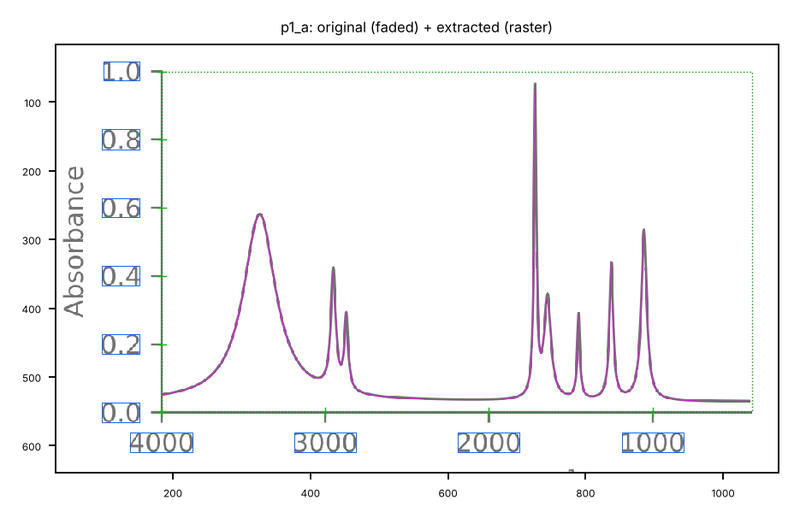
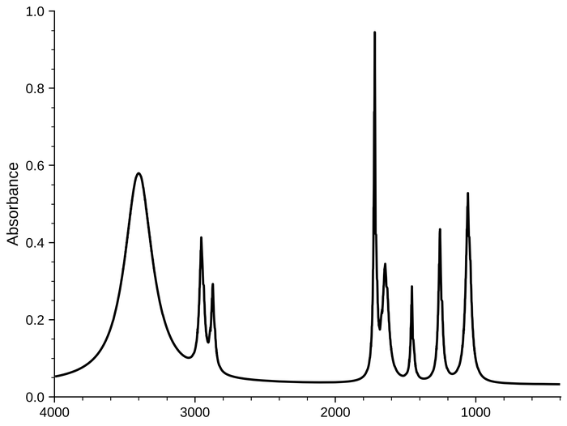

# 2 · Spectra and reversed axes

**Example:** [`examples/02_ir_spectrum/ir_spectrum.png`](../../examples/02_ir_spectrum). It is an IR absorbance spectrum with the wavenumber axis running from 4000 down to 400 cm⁻¹, open axes (no top or right frame), and peaks as narrow as 9 cm⁻¹.

```bash
cd examples/02_ir_spectrum
resrijan digitize ir_spectrum.png -o output -v
```

```text
  p1_a     line        raster          1 series               warnings: 0  errors: 0
      [info] x-axis is reversed (values decrease along the axis).
      [info] Resolution: 1 px = 4.2 (x), 0.00201 (y) data units near the axis centre.
```



## How sharp peaks are handled

On flat parts of the curve the position is taken per pixel column. On steep flanks a column contains a long vertical run of ink, so ReSrijan switches to per-row centroids along the flank and walks up one side and down the other. The doublet near 2900 cm⁻¹ and the shoulder near 1640 cm⁻¹ survive intact. The trace is then lightly smoothed along its length, over about 1.5 line widths, which removes pixel stair-steps without rounding off real features.

Accuracy: 0.084 % RMS of the axis range (0.040 % from the vector PDF version of the same spectrum).

## Replot

The reversed axis is kept, and the limits are snapped to the original's tick values (4000 and 400):



## Tips

* **Resolution limit.** "1 px = 4.2 cm⁻¹" is the size of one image pixel in data units. Features narrower than about 2 px cannot be recovered from a bitmap. Use the vector PDF, or a higher-resolution scan, when the peak widths matter.
* **Axis title.** Titles containing mathematics (cm⁻¹) are hard to OCR. If the replot shows no title or a garbled one, set it: `--xlabel 'Wavenumber (cm$^{-1}$)'`.

Next: [3 · Logarithmic axes](03-log-axes.md)
