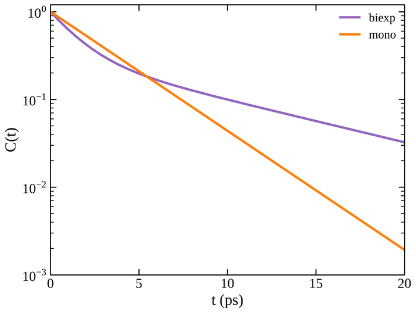
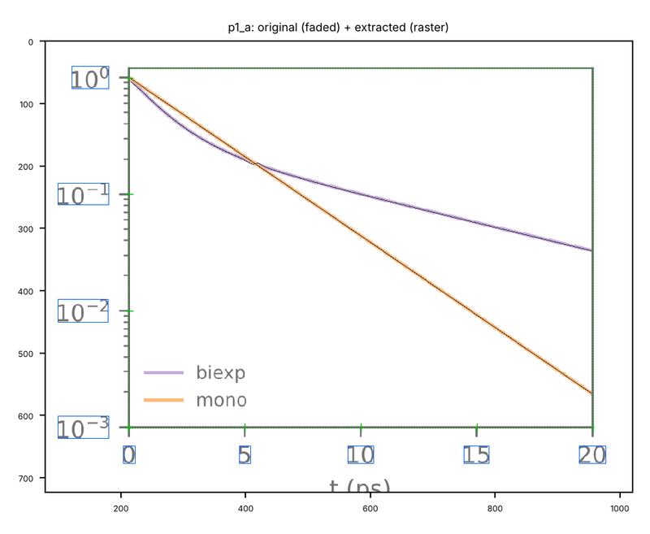

# 3 · Logarithmic axes

**Example:** [`examples/03_log_axis/`](../../examples/03_log_axis). It shows two correlation-function decays on a log y-axis labelled 10⁻³ … 10⁰, saved as EPS and as PNG.

## EPS input

```bash
cd examples/03_log_axis
resrijan digitize log_decay.eps -o output/eps -t aps -v
```

```text
  p1_a     line        vector          2 series               warnings: 0  errors: 0
      [info] y-axis is logarithmic.
```

The EPS file is converted to PDF with Ghostscript, so it stays vector. The exponents are read from the glyph geometry: a smaller, raised "−3" after "10" means 10⁻³. Both a linear and a logarithmic fit are tried, and the log model wins because the labels lie evenly spaced in log₁₀(value). Accuracy: 0.011 % RMS of the axis range, measured in decades.

Replot with the APS (Physical Review) template: 86 mm column, Times-style serif fonts, inward mirrored ticks:



## PNG input

```bash
resrijan digitize log_decay.png -o output/png -v
```



In a bitmap, the superscript exponents are found from where the characters sit: a group of glyphs whose bottom lies well above the baseline of the "10" is an exponent, and it is read separately. Minus signs are found from their shape, because OCR often drops them. Accuracy: 0.108 % RMS.

## Tips

* **Misread label.** If one label is misread (say "10⁻²" read as "10²"), the fit rejects it and the report names it. You only need two good labels for a calibration.
* **Forcing the scale.** Force a scale with `--yscale log` or `--xscale log`; for a manual calibration see [tutorial 11](11-manual-calibration.md).
* **Log errors in the CSV.** The CSV holds the plain values (0.001, not −3). To check errors on a log axis, compare log₁₀ values.

Next: [4 · Scatter plots with error bars](04-scatter-errorbars.md)
