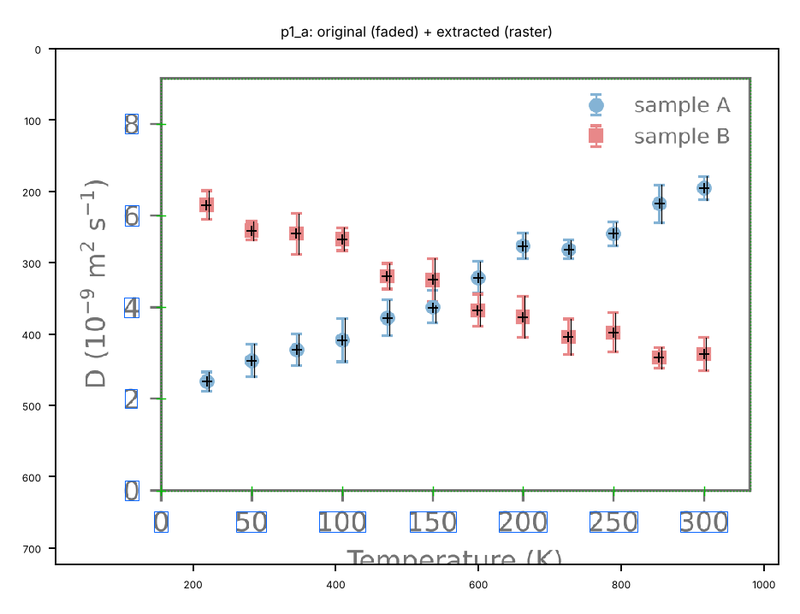
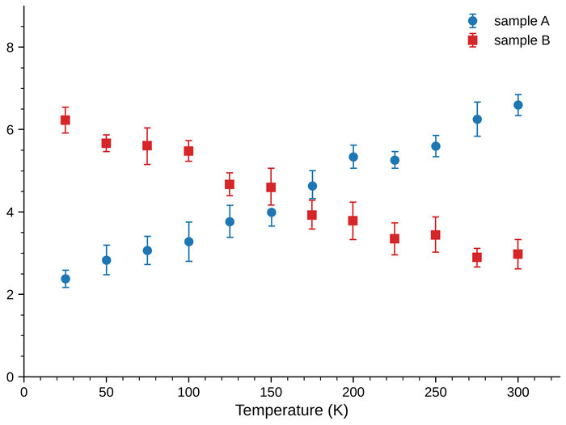

# 4 · Scatter plots with error bars

**Example:** [`examples/04_scatter_errorbars/scatter_err.png`](../../examples/04_scatter_errorbars). It has two series of 12 symbols each, blue circles and red squares, with capped error bars and a legend. Some symbols overlap.

```bash
cd examples/04_scatter_errorbars
resrijan digitize scatter_err.png -o output -v
```

```text
  p1_a     scatter     raster          2 series               warnings: 0  errors: 0
```



The crosses mark the symbol centres that were found, and the short bars beside them the error-bar extents.

## How symbols are found

1. Each colour is separated (as in [tutorial 1](01-line-plots.md)). The thin error-bar lines are removed by a morphological opening, which leaves compact blobs of similar size: the symbols.
2. Each symbol position is the centre of its blob. Two symbols that touch form one blob of double area; it is split in two.
3. A symbol that is partly hidden is recovered by matching the shape of a clean one (template matching).
4. **Error bars:** from each centre the column of the same colour is followed up and down to the whisker ends, and the cap's centre line is used as the end.

Result (`output/scatter_err_p1_a_data.csv`). `yerr_minus` and `yerr_plus` are the lengths of the lower and upper error bars in data units:

```text
series,x,y,yerr_minus,yerr_plus,kind,source
sample A,25.15504845,2.378213063,0.210116,0.210116,markers,raster
sample A,50.00009522,2.829574111,0.350194,0.365758,markers,raster
...
```

Accuracy: all 24 points found, positions within 0.125 % RMS of the axis range, and error-bar lengths within 0.36 % of the axis range. From the PDF version, all of these are exact.

## Replot

The series come out in legend order, so sample A keeps circles and sample B squares. The y-axis title of this figure contains a superscript and was not read, so add it yourself:

```bash
resrijan digitize scatter_err.png -o output --ylabel 'D (10$^{-9}$ m$^2$ s$^{-1}$)'
```



## Tips

* **Line-and-symbol series.** For a line through symbols, the symbol centres are reported; they are the measured points.
* **Limits.** Hollow symbols that are partly hidden under another series in a *bitmap* can be missed. The vector version of the same figure is always exact.

Next: [5 · Bar charts](05-bar-charts.md)
