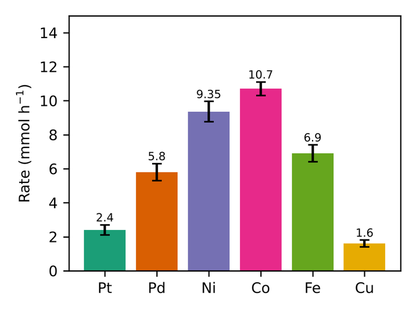
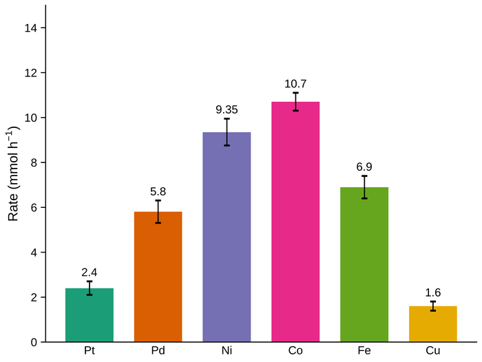
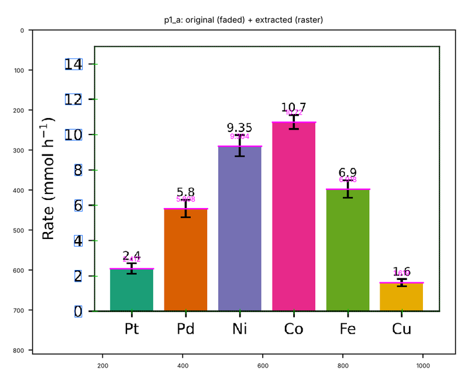

# 5 · Bar charts

**Example:** [`examples/05_bar_chart/`](../../examples/05_bar_chart). Six bars with named categories (Pt … Cu), error bars, and the value printed above each bar. It is saved as SVG (text drawn as outlines) and as PNG.



## SVG input

```bash
cd examples/05_bar_chart
resrijan digitize bar_err.svg -o output/svg -v --ylabel 'Rate (mmol h$^{-1}$)'
```

```text
  p1_a     bar         vector          6 bars                 warnings: 0  errors: 0
      [info] x-axis is categorical: Pt, Pd, Ni, Co, Fe, Cu
      [info] Tick labels are not stored as text in this file; read by OCR.
      [info] 'Pt': height 2.4 agrees with its label 2.4.
      [info] 'Pd': height 5.8 agrees with its label 5.8.
      [info] 'Ni': height 9.35 agrees with its label 9.35.
      [info] 'Co': height 10.7 agrees with its label 10.7.
      [info] 'Fe': height 6.9 agrees with its label 6.9.
      [info] 'Cu': height 1.6 agrees with its label 1.6.
```

`output/svg/bar_err_p1_a_bars.csv`:

```text
category,value,err_plus,err_minus,annotated_value,x_left_px,x_right_px,top_px,color_hex
Pt,2.399921,0.300077,0.299698,2.4,436.325,652.117,1193.717,#1b9e77
Pd,5.7999312,0.50022,0.499844,5.8,706.083,921.842,893.458,#d95f02
Ni,9.3499782,0.600152,0.600057,9.35,975.817,1191.608,579.950,#7570b3
Co,10.699848,0.399913,0.399912,10.7,1245.542,1461.333,460.742,#e7298a
Fe,6.8998315,0.50022,0.499749,6.9,1515.267,1731.058,796.325,#66a61e
Cu,1.6000015,0.200145,0.200144,1.6,1784.992,2000.783,1264.358,#e6ab02
```



## What is checked

* **Bars.** In a vector file, a bar is a set of filled rectangles standing on the x-axis, grouped by colour and adjacency. A bar that an editor built from dozens of thin slices with fading opacity (a common Inkscape gradient trick) still counts as one bar. A rectangle that does not stand on the axis, for example a misplaced copy, is reported as a *stray shape*.
* **Categories** are the words under the axis, assigned to bars from left to right.
* **Printed values** above the bars are compared with the drawn heights. A disagreement larger than the label's rounding is reported as a warning. This catches figures whose bars were drawn or edited by hand.
* **Error bars** are the dark vertical strokes centred on each bar.

## PNG input

```bash
resrijan digitize bar_err.png -o output/png -t jcp -v
```



From pixels, each bar is a solid block of colour standing on the axis. Its top is located to a fraction of a pixel, and pieces of one bar separated by a hairline gap are joined. Accuracy: within 0.15 % of the axis range, and error bars within 0.30 %. OCR slips in number-and-unit category names, such as "lOh" for "10h" or "2H" for "2h", are corrected from the pattern of the other labels.

## Tips

* **Coloured axes.** Bars standing on a coloured axis line, such as a blue x-axis, are handled.
* **Pale bars in bitmaps.** Very light bar colours (pastel palettes) can spoil the OCR of the category names in a bitmap; the vector file is read correctly.
* **Not yet supported:** horizontal bars and stacked bars.

Next: [6 · Heat maps and 2D-IR spectra](06-heatmaps-2dir.md)
