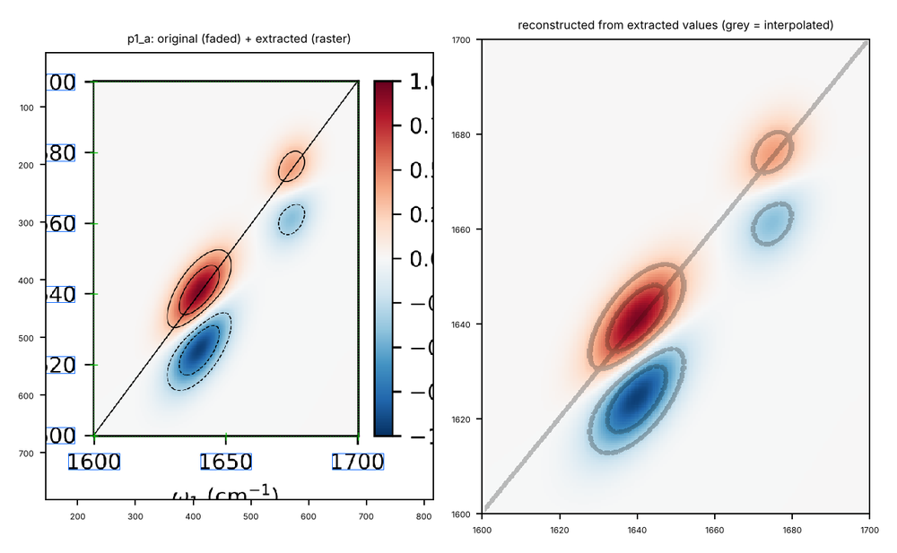
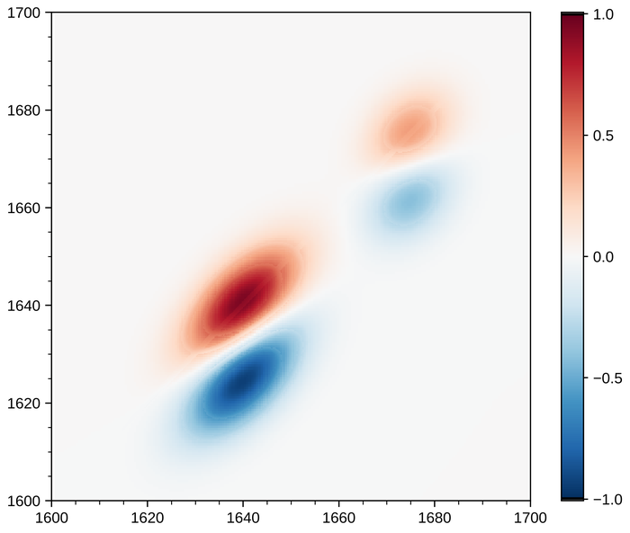

# 6 · Heat maps and 2D-IR spectra

**Example:** [`examples/06_heatmap_2dir/`](../../examples/06_heatmap_2dir). A 2D-IR-style spectrum (ω₁ against ω₃) with a diagonal peak, an anti-diagonal cross-peak of opposite sign, a diverging colour map (`RdBu_r`, −1 to 1), black contour lines and a diagonal line.

## PNG input

```bash
cd examples/06_heatmap_2dir
resrijan digitize heatmap_2dir.png -o output/png -v
```

```text
  p1_a     heatmap     raster          grid 452×609           warnings: 0  errors: 0
      [info] 4.5% of plot pixels are not colour-bar colours (contour lines, labels, overlays); filled from neighbours.
```

Left: the original. Right: the map rebuilt from the extracted numbers. Grey marks where values were interpolated under contour lines and the diagonal:



How the values are read:

1. **Colour bar.** It is found beside the plot, sampled along its length into a colour look-up table, and calibrated from its own tick labels. A white middle (as in diverging maps) does not break it.
2. **Each pixel's colour** is matched to the nearest point of the look-up table in CIELAB, with interpolation between neighbouring table entries. This gives sub-step precision for smooth maps.
3. **Overlays** (black contour lines, the diagonal, text) are recognised as colours that are not in the colour bar. They are removed and filled smoothly from the surrounding values.

Accuracy: 0.43 % RMS of the colour range (PNG), 0.75 % (JPG at quality 80).

## PDF input with an embedded image

```bash
resrijan digitize heatmap_2dir.pdf -o output/pdf -v
```

```text
  p1_a     heatmap     embedded-image  grid 306×411           warnings: 0  errors: 0
      [info] Map stored as an embedded 306×411 image: values read from its native pixels.
```

Most plotting programs store the map in a PDF as a bitmap. ReSrijan reads that bitmap at its own resolution instead of a re-rendering, so there is no interpolation and no overlay to remove. Accuracy: 0.28 % RMS.

## Output

* `*_grid.csv`: the first row holds the x values (ω₁), the first column the y values (ω₃), and the body z. It opens directly in Origin, Excel or NumPy (`np.genfromtxt(..., delimiter=',')`).
* `*_grid.npz`: `x`, `y`, `z`, plus a mask `filled` of the interpolated pixels.
* `*_contours.csv`: the contour overlay lines, in data coordinates.

Replot, with the original colour map rebuilt from the colour bar:



## Tips

* **Clipped colours.** If many pixels sit at either end of the colour bar, the report warns that values are clipped: the true extrema of the spectrum may be larger than the colour range shows.
* **Contour lines.** The replot does not redraw the original contour lines (they are in `*_contours.csv`). To draw new ones from the extracted grid, use the `spectrum2d` panel type ([tutorial 12](12-plot-your-data.md)).

Next: [7 · Filled contour plots](07-contour-plots.md)
