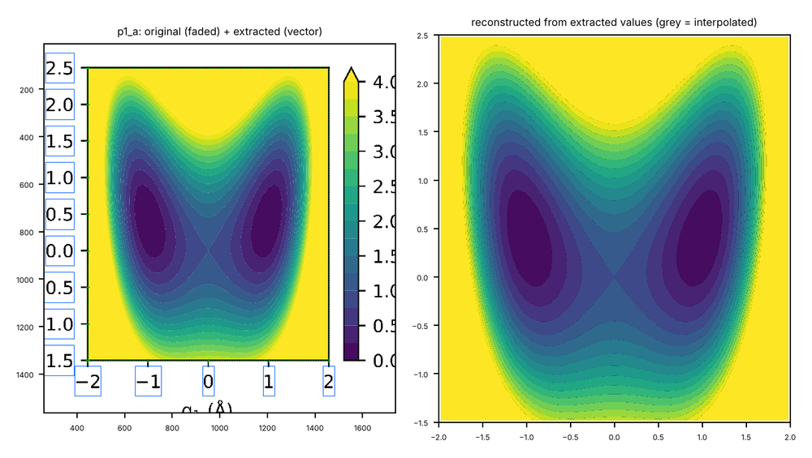
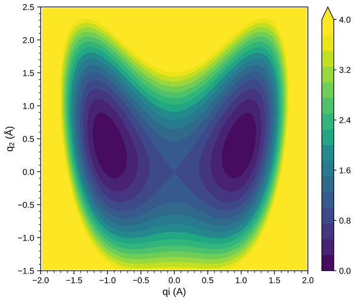

# 7 · Filled contour plots

**Example:** [`examples/07_contour/contourf_pes.pdf`](../../examples/07_contour). A two-dimensional potential-energy surface drawn as 16 filled levels between 0 and 4 kcal/mol (viridis), with an "extend" triangle on the colour bar for values above 4.

```bash
cd examples/07_contour
resrijan digitize contourf_pes.pdf -o output -v
```

```text
  p1_a     contourf    vector          grid 1003×1222         warnings: 0  errors: 0
      [info] Top colour band means 'above 4' (open-ended).
      [info] 2.0% of plot pixels are not colour-bar colours (contour lines, labels, overlays); filled from neighbours.
```



## Discrete levels

A filled contour plot does not hold continuous values. Each colour stands for an interval (here 0.25 kcal/mol wide), so ReSrijan detects that the colour bar is made of flat bands and reports intervals:

* `z` in the `.npz` and `.csv` files is the middle of each pixel's band;
* `lo` and `hi` in the `.npz` file are the band limits. The band edges are snapped to the evenly spaced level grid read from the colour-bar labels;
* the "extend" band at the top is open-ended (`hi = inf`) and means "above 4".

Accuracy: 98.8 % of pixels are assigned to exactly the right level, and 100 % to the right level or its neighbour. The few one-level slips lie on band edges.

Replot with the same levels and colours:



Next: [8 · Micrographs](08-micrographs.md)
