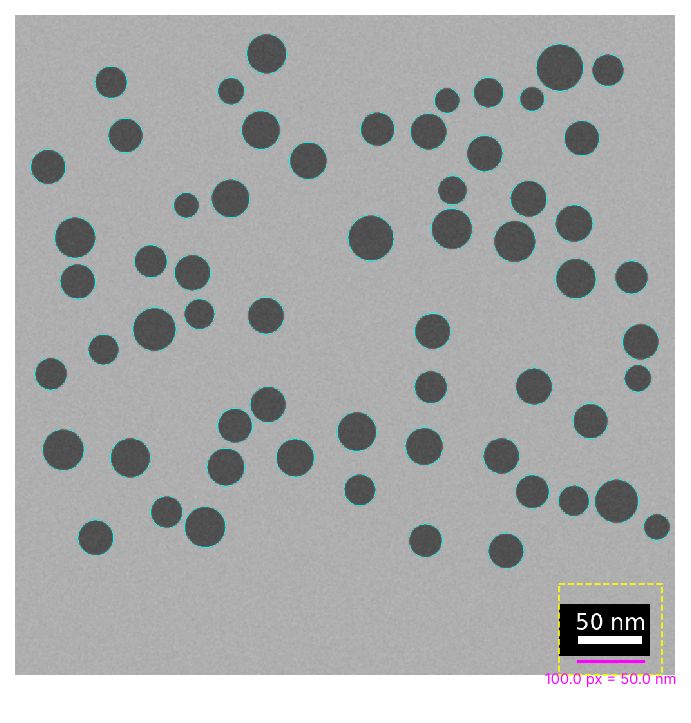
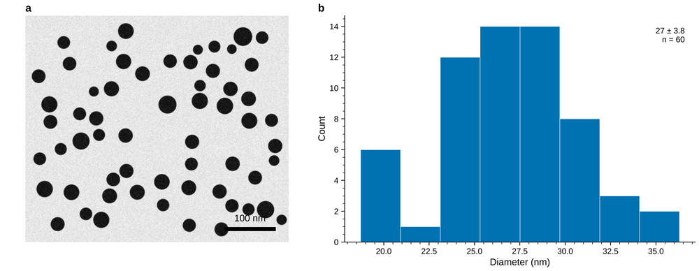

# 8 · Micrographs

**Example:** [`examples/08_micrograph/micrograph_tem.png`](../../examples/08_micrograph). A TEM-style image of 60 particles (true pixel size 0.5 nm), with a white 50 nm scale bar on a black label panel.

```bash
cd examples/08_micrograph
resrijan digitize micrograph_tem.png -o output -v
```

```text
  p1_a     micrograph  raster          0.5 nm/px              warnings: 0  errors: 0
      [info] Scale bar 50 nm = 100.00 px → 0.5 nm/px (±0.005 nm/px from ±1 px edge uncertainty).
```

A picture without plot axes and with photographic content is treated as a micrograph automatically. You can force this with `--type micrograph`.



In the overlay, the magenta line is the measured scale bar, the dashed yellow box is the annotation area left out of the analysis, and the cyan outlines are the detected particles.

## Scale bar

* The bar is found as a solid white or black rectangle at least four times wider than it is tall. Its length is measured to a fraction of a pixel, at the points where the brightness crosses halfway between bar and background at each end.
* The text next to it ("50 nm") is read by OCR. Units nm, µm (or um), Å, pm and mm are understood.
* The label panel behind the bar and text, and an SEM information strip along the bottom if there is one, are left out of the analysis.

If the bar has no readable text, give the scale yourself as pixels = value unit:

```bash
resrijan digitize image.tif --type micrograph --scale "100=50 nm"
```

## Particle sizing

The particles are separated from the background by an automatic (Otsu) threshold, and touching particles are split with a watershed. Each particle's diameter is that of a circle with the same area. Particles cut by the image edge are excluded from the statistics.

| | true | ReSrijan |
|---|---|---|
| pixel size | 0.5000 nm | 0.5000 nm |
| particles | 60 | 60 |
| mean diameter | 27.02 nm | 27.04 nm (+0.06 %) |
| standard deviation | 3.84 nm | 3.84 nm |

Outputs: `*_particles.csv` (one row per particle), `*_calibrated.tif` (the image with its physical pixel size stored in the file, readable by ImageJ/Fiji), and a two-panel figure: the image with a new journal-style scale bar, and the size histogram:



## Checks

The report warns about clipped intensities (saturated black or white pixels), 8×8 JPEG block artefacts, and a missing or unreadable scale bar.

Figures that combine several images (an HRTEM image with magnified insets and d-spacing labels, or a time-lapse row of photographs) are covered in [16 · Image figures](16-image-figures.md).

Next: [9 · Multi-panel pages](09-multipanel-pages.md)
