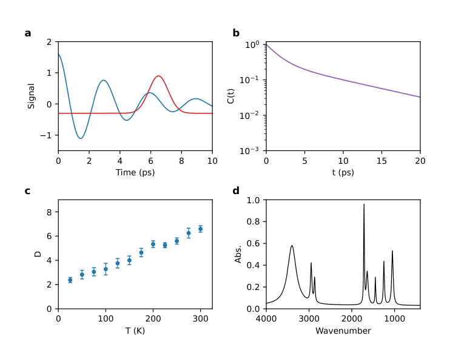
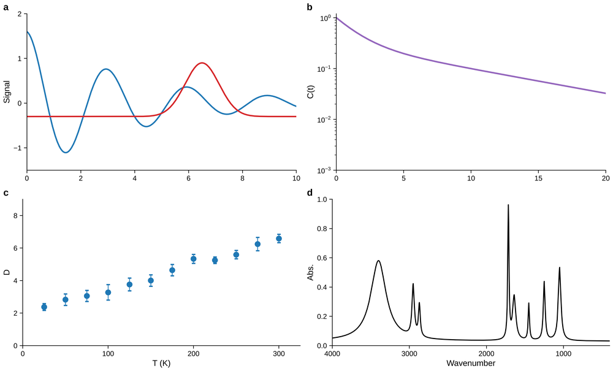

# 9 · Multi-panel pages

**Example:** [`examples/09_multipanel_page/multipanel_page.pdf`](../../examples/09_multipanel_page). A journal-style figure with four panels: (a) two lines, (b) a log decay, (c) symbols with error bars, (d) an IR spectrum with a reversed axis.



```bash
cd examples/09_multipanel_page
resrijan digitize multipanel_page.pdf -o output -t natchem -v
```

```text
  p1_a     line        vector          2 series               warnings: 0  errors: 0
  p1_b     line        vector          1 series               warnings: 0  errors: 0
      [info] y-axis is logarithmic.
  p1_c     scatter     vector          1 series               warnings: 0  errors: 0
  p1_d     line        vector          1 series               warnings: 0  errors: 0
      [info] x-axis is reversed (values decrease along the axis).
```

Every plot area on the page is found and processed on its own, in reading order (top to bottom, then left to right). The search for tick labels stops at neighbouring panels, so a label is never claimed by the wrong panel.

Besides one set of files per panel, you get **`multipanel_page_combined.*`**: all panels rebuilt at the journal's double-column width, arranged automatically and labelled a–d in the journal's style:



## Choosing pages and regions

```bash
resrijan digitize paper.pdf --page 5                    # only page 5 (1-based)
resrijan digitize paper.pdf --page 5,6                  # pages 5 and 6
resrijan digitize paper.pdf --page 5 --region 0.08,0.10,0.52,0.40
```

`--region` takes `x0,y0,x1,y1`, either as page fractions (0–1, measured from the top-left corner) or in pixels of the rendered page. To find the pixel coordinates, `resrijan inspect paper.pdf --page 5` writes an image of the page with a pixel grid on it ([tutorial 11](11-manual-calibration.md)).

## Tips

* **Bitmap figures in PDFs.** Journal PDFs often contain a figure as a bitmap. ReSrijan then falls back to image analysis automatically (the mode shows `raster`). The rendering resolution is set by `--dpi`, 600 by default.
* **Micrographs in PDFs.** A page that holds only a micrograph (an embedded image without plot axes) is analysed as a micrograph at the image's native resolution. If the micrograph shares a page with plots, select it with `--region` and add `--type micrograph`.
* **`--region` and vector data.** Cropping with `--region` uses the rendered image, so vector extraction is switched off for that run. To keep exact vector data on a busy page, run without `--region` and pick the panel you need from the output.

Next: [10 · SVG, EPS and PS files](10-svg-eps-ps.md)
