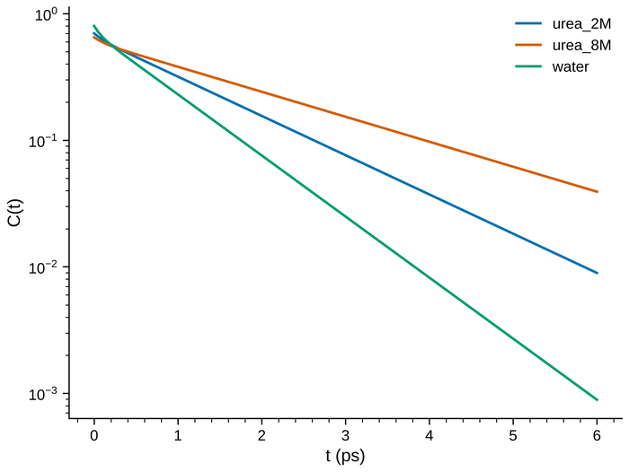
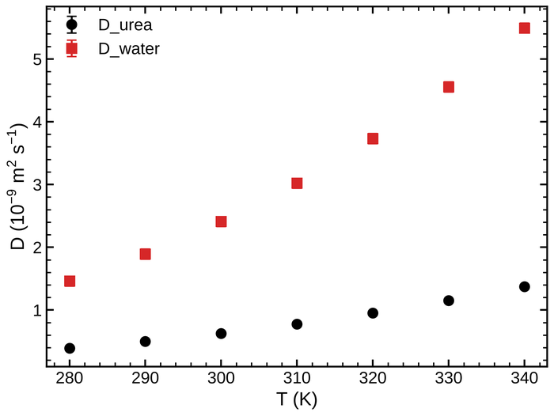
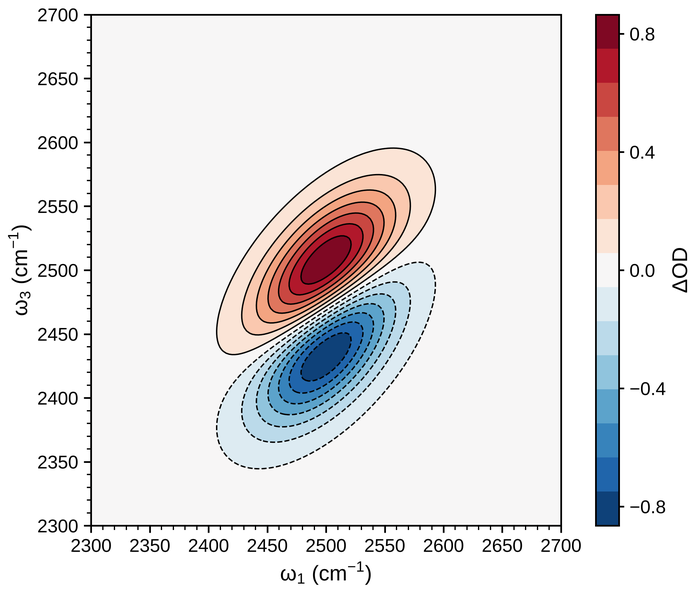

# 12 · Plot your own data

ReSrijan is also a stand-alone figure engine: give it a data file and a journal name, and it draws the figure to that journal's size, fonts, line widths and tick style. Examples: [`examples/10_plot_your_data/`](../../examples/10_plot_your_data).

## Line plot (Nature Chemistry)

`correlation.csv` has a header row and the columns `t_ps,urea_2M,urea_8M,water`.

```bash
cd examples/10_plot_your_data
resrijan plot correlation.csv -x t_ps -y urea_2M,urea_8M,water --yscale log \
    --xlabel 't (ps)' --ylabel 'C(t)' -t natchem -o output/correlation_natchem
```



## Symbols with error bars (ACS)

```bash
resrijan plot diffusion.csv --kind scatter -x T_K -y D_urea,D_water --yerr err_urea,err_water \
    --xlabel 'T (K)' --ylabel 'D (10$^{-9}$ m$^2$ s$^{-1}$)' -t acs -o output/diffusion_acs
```



## 2D spectrum (PNAS)

`2dir_grid.csv` is a matrix: x values in the first row, y values in the first column. This is the same layout ReSrijan writes for heat maps.

```bash
resrijan plot 2dir_grid.csv --kind spectrum2d --xlabel '$\omega_1$ (cm$^{-1}$)' \
    --ylabel '$\omega_3$ (cm$^{-1}$)' --clabel 'ΔOD' -t pnas -o output/2dir_pnas
```



`spectrum2d` draws filled contours with contour lines on top. For diverging data an odd number of bands is used, so that one band straddles zero and noise near zero shows no speckle.

## Colours and title colour

`--colors` sets the colour of each y series in order; leave an entry empty to keep the journal palette's colour. `--label-color` colours the axis and colour-bar titles (journals usually want black, the default). Any matplotlib colour works: names (`navy`), hex codes (`'#0072B2'`) or grey levels (`'0.3'`).

```bash
resrijan plot diffusion.csv --kind errorbar -x T_K -y D_urea,D_water --yerr err_urea,err_water \
    --colors '#D55E00,#0072B2' --label-color navy -o output/diffusion_colours
```

`resrijan digitize` takes `--label-color` as well; without it, the replot keeps the title colour read from the figure.

## Kinds of plot

| `--kind` | data |
|---|---|
| `line` (default) | table: `-x` one column, `-y` one or more columns |
| `scatter`, `errorbar` | table, optionally `--yerr` columns |
| `bar` | table: categories in `-x`, values in `-y` |
| `heatmap`, `contourf`, `contour`, `spectrum2d` | matrix CSV or `.npz` (`x`, `y`, `z`) |
| `image` | TIFF/PNG; `--nm-per-px` adds a scale bar |
| `hist` | table, `--column` |

Tables can be CSV, TSV or whitespace-separated. Lines starting with `#` are ignored. Columns are named by the header row; a file without a header gets `c0, c1, …`. The CSV files written by `resrijan digitize` can be plotted directly.

## Exports

`-f pdf,svg,eps,png,tiff` (default `pdf,svg,png`):

* **PDF and EPS** embed TrueType fonts, so the text stays editable in Illustrator and Inkscape.
* **SVG** keeps text as real text and lists the journal's font stack (for example *Arial, Helvetica, Liberation Sans*), so the right font is used wherever the file is opened.
* **PNG and TIFF** are written at the template's resolution (600 dpi); TIFF is LZW-compressed and has its dpi tag set.

Next: [13 · Compose a multi-panel figure](13-compose-figures.md)
