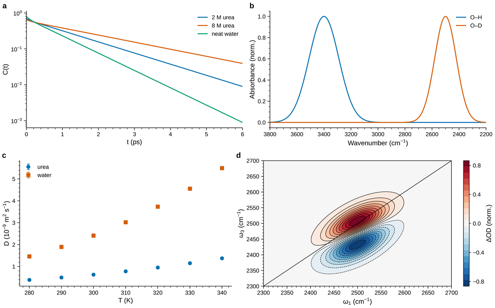

# 13 · Compose a multi-panel figure

Describe the panels in a YAML file, and ReSrijan arranges them, sizes them to the journal's width, and labels them. Example: [`examples/11_compose_figure/figure_natchem.yaml`](../../examples/11_compose_figure/figure_natchem.yaml).

```yaml
figure:
  template: natchem          # natchem | acs | aps | jcp | science | pnas | rsc | presentation | path/to/own.yaml
  width: double              # single | onehalf | double | <mm>
  labels: true               # a, b, c … in the journal's style
  formats: [pdf, svg, png, tiff]
  output: output/figure_natchem
panels:
  - type: line
    data: data/correlation.csv
    x: t_ps
    y: [urea_2M, urea_8M, water]
    labels: ["2 M urea", "8 M urea", "neat water"]
    xlabel: "t (ps)"
    ylabel: "C(t)"
    yscale: log
    xlim: [0, 6]
  - type: line
    data: data/ir_spectra.csv
    x: wavenumber
    y: [OH_stretch, OD_stretch]
    labels: [O–H, O–D]
    xlabel: "Wavenumber (cm$^{-1}$)"
    ylabel: "Absorbance (norm.)"
    xlim: [3800, 2200]       # reversed axis, IR convention
  - type: scatter
    data: data/diffusion.csv
    x: T_K
    y: [D_urea, D_water]
    yerr: [err_urea, err_water]
    labels: [urea, water]
    xlabel: "T (K)"
    ylabel: "D (10$^{-9}$ m$^{2}$ s$^{-1}$)"
  - type: spectrum2d
    data: data/2dir_grid.csv
    xlabel: "$\\omega_1$ (cm$^{-1}$)"
    ylabel: "$\\omega_3$ (cm$^{-1}$)"
    clabel: "ΔOD (norm.)"
    levels: 21
    diagonal: true
```

```bash
cd examples/11_compose_figure
resrijan compose figure_natchem.yaml
```



## How the layout is chosen

Panels keep their reading order (a, b, c … from left to right, then top to bottom). Every way of splitting that order into rows is scored, and the best one is used:

* each panel's printed width should be close to a comfortable size for the column width (about 70 mm in a 183 mm double column);
* images keep their true aspect ratio, while plots may stretch between 0.75 and 1.6 times their preferred ratio;
* the whole figure must fit the journal's maximum height;
* balanced rows (3 + 3) are preferred to lopsided ones (4 + 2).

To fix the arrangement yourself, add `rows: [[0, 1, 2], [3]]` (panel indices) under `figure:`. To aim for a particular height, add `height: 120` (mm).

## Panel options

Every panel accepts `xlabel`, `ylabel`, `xlim`, `ylim`, `xscale`, `yscale`, `legend` (true, false or a position such as `"upper right"`), `title`, `aspect` (preferred width/height ratio), `annotations` (`[{text: "x", xy: [1, 2]}]`) and `minor_ticks`. Line and scatter panels also take `colors`, `labels` and `style: {marker: o, linestyle: "--"}`. Maps take `cmap`, `vmin`, `vmax`, `levels`, `contour_lines`, `diagonal`, `clabel` and `colorbar: false`. Image panels take `nm_per_px`, `scalebar` (`auto` or, for example, `"100 nm"`) and `crop`.

## Using digitised data

The CSV files from `resrijan digitize` can go straight into a spec. A long-format file (with a `series` column) becomes one series per name. This example uses the output of [tutorial 1](01-line-plots.md):

```yaml
  - type: line
    data: ../01_line_plot/output/png/line_multi_p1_a_data.csv
    xlabel: "Time (ps)"
```

This is how to rebuild a published figure next to your own results with one consistent style.

Next: [14 · Journal templates](14-journal-templates.md)
