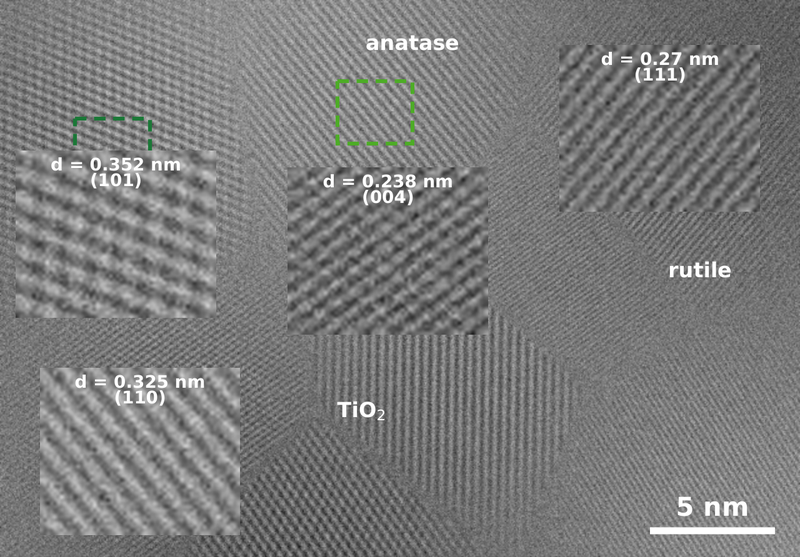
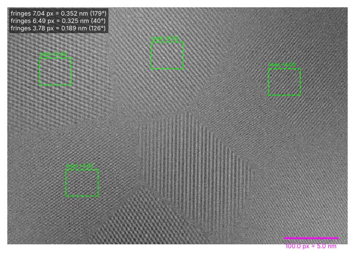
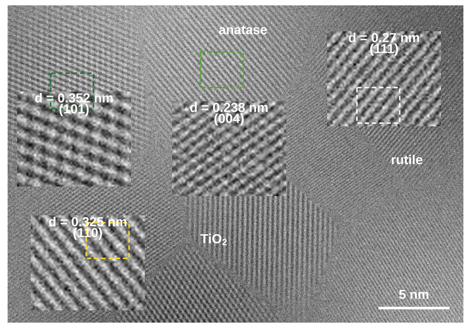
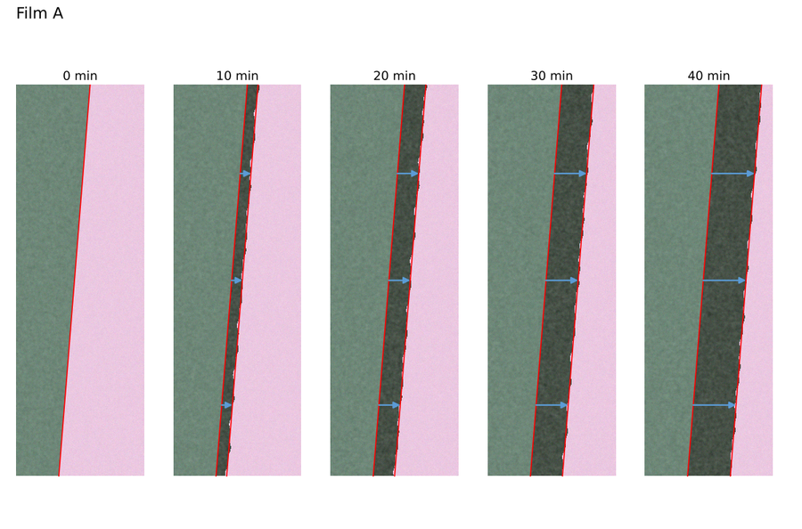
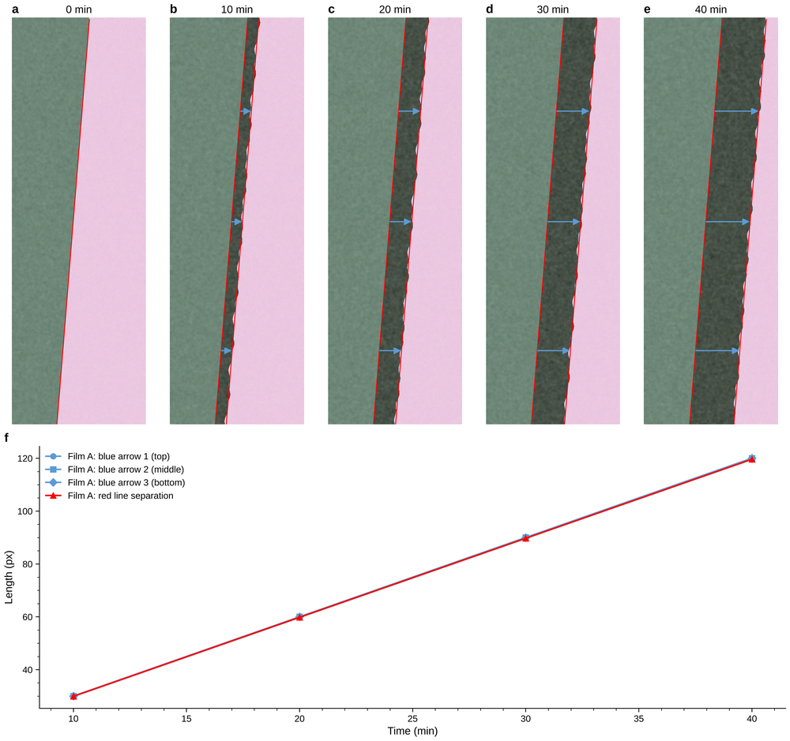

# 16 · Image figures: HRTEM with insets, time-lapse photographs

Tutorial 8 covers a single micrograph. Published figures often combine several images instead: a high-resolution TEM image with magnified insets and d-spacing labels, or a row of optical photographs taken over time with lines and arrows drawn on them. ReSrijan treats every photograph or micrograph on a page as a **frame**, never as a plot. Images without axes produce no "missing tick label" errors.

Both examples were drawn from known data (`truth.json` in each folder), so every number below can be checked.

## HRTEM image with insets

**Example:** [`examples/12_hrtem_insets/hrtem_insets.pdf`](../../examples/12_hrtem_insets)



The figure has these parts:

- **Main image:** a 640 × 480 px HRTEM-like image at 0.05 nm/px, with crystalline grains of known lattice spacings.
- **Clipped strip:** the microscope's info strip and its own 5 nm bar are clipped away by the figure, as Inkscape and Illustrator do when a photo is cropped.
- **Scale bar and labels:** the figure draws its own 5 nm scale bar, plus phase labels and dashed boxes.
- **Insets:** four ×4 enlargements carry "d = … nm (hkl)" labels. One label is deliberately wrong: it says 0.27 nm where the true spacing is 0.248 nm.

```bash
cd examples/12_hrtem_insets
resrijan digitize hrtem_insets.pdf -o output -v
```

```text
  p1_a     micrograph  vector-image    0.05 nm/px             warnings: 0  errors: 0
      [info] Only native px (0, 0)–(640, 446) of the 640×480 bitmap are visible (the rest is clipped in the figure).
      [info] Scale bar 5 nm = 100.00 native px (drawn in the figure) → 0.05 nm/px.
      [info] Microscope's own bar (hidden by the figure's clip): 5 nm = 100.0 px → 0.05 nm/px; the figure's bar differs by +0.0%.
  p1_b     micrograph  vector-image    0.0125 nm/px           warnings: 1  errors: 0
      [info] Inset matches the parent image magnified ×4.000 at native px (490, 115)–(550, 165), correlation 0.99.
      [info] Scale from the parent's bar via the match: 0.0125 nm/px.
      [warn] Printed d = 0.27 nm (111); measured (strongest fringe set, 19.81 px) d = 0.248 ± 0.001 nm, -8.3% — outside the ±3% uncertainty; check the label or the scale.
  p1_c     micrograph  vector-image    0.0125 nm/px           warnings: 0  errors: 0
      [info] Printed d = 0.352 nm (101); measured (strongest fringe set, 28.21 px) d = 0.353 ± 0.001 nm, +0.2% (agrees within ±3%).
  …
```

### What it reads

* **Native pixels.** Images embedded in PDF, EPS and SVG files are taken from the file at their original resolution, not from a rendering. Parts the figure clips away are found by comparing the bitmap with the rendered page, and left out.
* **Scale bars, in order of reliability:**
  1. a bar drawn as a vector line with its text ("5 nm"), which is exact;
  2. the microscope's own bar burnt into the bitmap, solid or bracket-shaped (|‾‾‾|), even where the figure hides it;
  3. a bar found in the pixels with its text read by OCR, for bitmap files.

  When several are present they are cross-checked against each other.
* **Insets.** An image lying inside another is matched to its source region by multi-scale correlation, which gives the magnification (here ×4.000) and the inset's pixel size. An unlabelled scale bar in an inset is then reported in nm.
* **Lattice fringes.** The strongest periodicities come from the 2-D FFT, refined by a zoomed DFT. The ± comes from the spread between the four image quadrants. On synthetic lattices the period comes out within 0.02 % RMS. Periodicities finer than the original image could resolve (below 2.2 px × magnification in an enlargement) are interpolation artefacts and are ignored.
* **d-spacing labels.** "d = 0.352 nm (101)" is parsed and compared with the measured fringe period. A difference larger than the combined uncertainty is a warning: check the label, the indexing or the scale bar.

| inset label | true d | measured | verdict |
|---|---|---|---|
| 0.352 nm (101) | 0.352 nm | 0.353 ± 0.001 nm | agrees |
| 0.238 nm (004) | 0.238 nm | 0.238 ± 0.000 nm | agrees |
| 0.27 nm (111) | 0.248 nm | 0.248 ± 0.001 nm | **flagged (−8.3 %)** |
| 0.325 nm (110) | 0.325 nm | 0.326 ± 0.001 nm | agrees |

The overlay marks each inset's source region (green), the measured scale bar (magenta) and every drawn annotation with its length:



### The rebuilt figure

The replot draws:

- the native image, with the insets in place;
- the authors' boxes, markers and scale bar, as vector paths;
- the labels, as editable text in the template font.



Outputs per frame:

- `*_image.png`: the native pixels, lossless.
- `*_calibrated.tif`: the same pixels with their pixel size stored, for ImageJ/Fiji.
- `*_lattice.csv`: fringe periods, d-spacings, angles and signal-to-noise.
- `*_annotations.csv`: every line, arrow and box, with its length in px and nm.
- `*_meta.json`: everything else.

A bitmap of the same figure (`hrtem_insets.png`) gives the main image and its scale bar from the pixels (5 nm = 200.02 px at the 200 dpi rendering). Insets cannot be separated from the image around them in a bitmap.

## Time-lapse photographs

**Example:** [`examples/13_timelapse/timelapse.svg`](../../examples/13_timelapse): five frames (0–40 min) of a layer growing at 3 px per minute. Red lines mark the interface and the growth front, and blue arrows measure the layer.



```bash
cd examples/13_timelapse
resrijan digitize timelapse.svg -o output -v
```

```text
  p1_b     micrograph  vector-image                           warnings: 1  errors: 0
      [info] Arrow (#5b9bd5) 30.0 px.
      …
      [info] Parallel #ff0000 lines 29.9 px apart.
  …
  p1_f     line        derived         4 series               warnings: 1  errors: 0
      [info] 4 series measured on 5 frames titled '0 min', '10 min', '20 min', '30 min', '40 min'.
```

* **Frame titles** ("10 min") are read, from text in vector files or by OCR in bitmaps.
* **Annotations.** Drawn lines, arrows and boxes on each frame are measured in the frame's native pixels:
  - arrows are measured from tail to visible tip;
  - pairs of parallel lines are measured as their perpendicular separation.

  In vector files these come from the drawing commands themselves and are exact. In bitmaps, strongly coloured thin strokes are traced; the arrows here come out within about 2 px at a 110 dpi rendering.
* **Series.** When the titles are numbers with a common unit, every measurement becomes a data series against that number. Each arrow is followed from frame to frame (top, middle, bottom), and each colour's line separation gets its own series. They are written to `*_data.csv` and plotted under the frames:



| time | true thickness | arrows (top/middle/bottom) | red-line separation (perpendicular) |
|---|---|---|---|
| 10 min | 30 px | 30.0 / 30.0 / 30.0 | 29.90 (true 29.90) |
| 40 min | 120 px | 120.0 / 120.0 / 120.0 | 119.61 (true 119.62) |

Without a scale bar, lengths are in native pixels, which is only meaningful when every frame has the same magnification. Give the pixel size to get physical units:

```bash
resrijan digitize timelapse.svg -o output --scale "100=50 um"     # 100 px = 50 µm
```

With that scale, the 40 min arrow becomes 60.0 µm.

## Mixed pages

On a page with both plots and photographs, each plot gets the usual treatment and each photograph becomes a frame. Lines inside a photograph that look like axes, such as an edge or a drawn red line, are not taken for a plot when there are no tick numbers next to them.

## Limits

* In a bitmap, an inset that touches its parent image without a white gap cannot be separated from it.
* In a bitmap, very short arrows (about 15 px or less, the 10 min arrows of `timelapse.png`) are not found; longer ones come out about 2 px short.
* Lattice analysis needs at least about 5 fringes across the image. Curved or strongly varying fringes widen the ±.
* Particle sizing (tutorial 8) runs only on a single grey-scale micrograph without lattice fringes.

Next: [17 · Tricky axes](17-tricky-axes.md)
