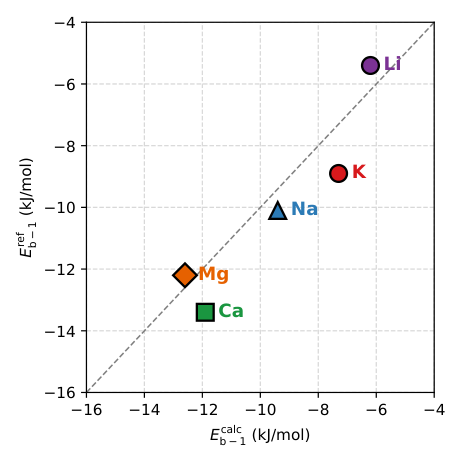
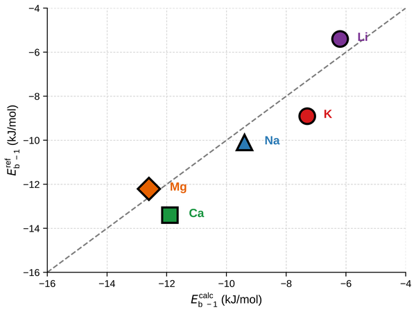
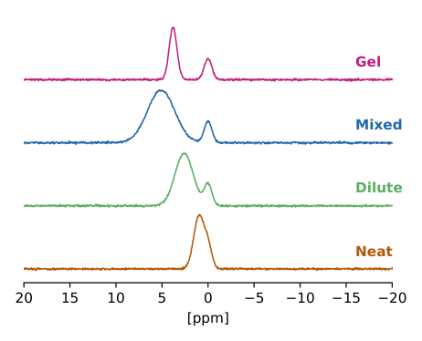
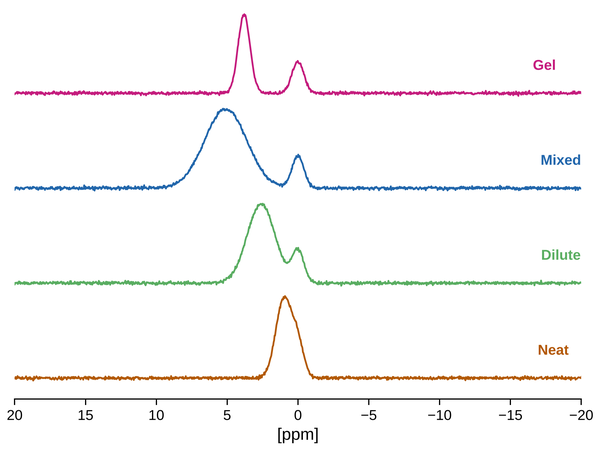
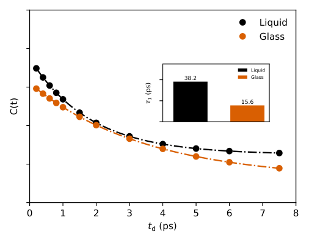
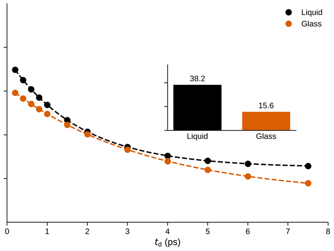
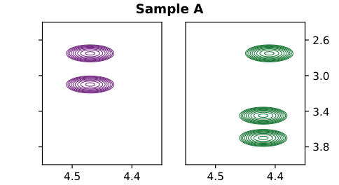
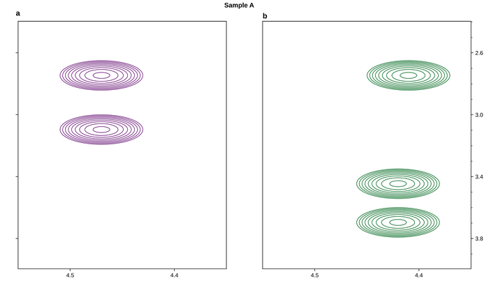

# 17 · Tricky axes: parity plots, stacked spectra, unnumbered axes, contour pairs

Real figures often leave out what a plain plot has: tick numbers on the y axis, a y axis at all, or a legend. This tutorial covers four such layouts, common in chemistry papers. Each example was drawn from known data (`examples/14_tricky_axes/truth.json`), so the numbers below can be checked.

```bash
cd examples/14_tricky_axes
```

## Parity plot with point labels

**Example:** `parity_plot.pdf`. Five single points, each in its own marker shape and colour, named by a label next to it instead of a legend. Also a dashed y = x line, a grid, and tick labels with minus signs.



```bash
resrijan digitize parity_plot.pdf -o output/parity -v
```

```text
  p1_a     line        vector          6 series               warnings: 0  errors: 0
      [info] Resolution: 1 px = 0.00633 (x), 0.00594 (y) data units near the axis centre.
```

* **One point is a series.** A single closed marker is kept as a marker series, with its shape (`o s D ^ v p h`), face colour and edge colour.
* **Direct labels name the points.** Text inside the plot is split into a legend (a column of evenly stacked labels) and point labels (scattered single labels). Each point label names the nearest marker of its colour. Labels in different colours are never merged, even when they touch.
* **The replot draws the labels where they were**, in their colour and weight. It draws no legend, because the labels already name everything.
* **Minus signs** that are drawn as small bars rather than as a "−" glyph (matplotlib mathtext, TeX) are attached to the tick numbers.
* **Square plots stay square**, and marker sizes and line widths keep their proportion to the plot.

| point | true (x, y) | read |
|---|---|---|
| Li | (−6.2, −5.4) | (−6.20, −5.40) |
| Na | (−9.4, −10.1) | (−9.40, −10.10) |
| K | (−7.3, −8.9) | (−7.30, −8.90) |
| Mg | (−12.6, −12.2) | (−12.60, −12.20) |
| Ca | (−11.9, −13.4) | (−11.90, −13.40) |



## Stacked spectra without a y axis

**Example:** `stacked_spectra.pdf`. Four NMR spectra offset vertically, a reversed ppm axis, no y axis, and the sample names written next to the traces.



```bash
resrijan digitize stacked_spectra.pdf -o output/stacked -v
```

```text
  p1_a     line        vector          4 series               warnings: 0  errors: 0
      [info] x-axis is reversed (values decrease along the axis).
      [info] No y axis (stacked/offset traces): intensities are relative, as a fraction of the panel height (0 = x axis, 1 = top); the stacking offsets are kept.
```

* **A long axis line with numbers under it and traces above it** is a plot even without a y axis. The panel reaches up to the highest trace, or to the label above it.
* **Intensities are relative:** 0 is the x axis and 1 is the top of the panel. The offsets between traces are kept, so the stack looks the same in the replot.
* **Clipped peaks.** A peak that the source cuts off at the top (a clip path in the PDF) ends the panel where it is cut, not at its hidden maximum. The replot cuts it in the same place.
* **Trace labels** in the trace's colour name the trace.

| spectrum | true peak | highest point of the read trace | baseline (fraction of height) |
|---|---|---|---|
| Neat | 1.0 ppm | 0.92 ppm | 0.053 |
| Dilute | 2.6 ppm | 2.48 ppm | 0.296 |
| Mixed | 5.1 ppm | 5.29 ppm | 0.538 |
| Gel | 3.8 ppm | 3.79 ppm | 0.779 |

The trace itself is exact (it is read from the vector path). The highest point differs from the true peak centre by up to 0.2 ppm only because of the noise drawn on the broad, flat-topped peaks. The baselines are equally spaced (0.243 of the height apart), as the offsets in the source are.



## A plot without y numbers, with a bar-chart inset

**Example:** `unnumbered_inset.pdf`. Two decay curves on a y axis that has ticks but no numbers. A small framed bar chart sits inside it, with its own colour legend and the values printed on the bars.



```bash
resrijan digitize unnumbered_inset.pdf -o output/inset -v
```

```text
  p1_a     bar         vector          2 bars                 warnings: 0  errors: 0
      [info] The y-axis has no numbers; calibrated from the values printed on the bars (38.2, 15.6), zero at the axis.
      [info] Bar names taken from the colour legend inside the plot.
      [info] 'Liquid': height 38.2 agrees with its label 38.2.
      [info] 'Glass': height 15.6 agrees with its label 15.6.
  p1_b     line        vector          4 series               warnings: 1  errors: 0
      [warn] The y-axis has no tick numbers: y is given as a fraction of the axis height (0 = bottom, 1 = top). Give --ycal 'px:value,px:value' for real units.
```

* **The inset is its own panel** (`p1_a`). Paths and text inside it are kept out of the main plot. Tick labels underneath it still belong to the main plot.
* **Bars calibrate their own axis** from the printed values, with zero at the axis line.
* **The main plot's y is relative** (0 = bottom, 1 = top) and is flagged as a warning. Pass `--ycal` if you know two values. Here the source axis ran from 0 to 1, so the relative values are the true values: all 24 points agree with `truth.json` to 0.0001.
* **The replot** draws the inset inside the main plot. It keeps the source's unnumbered ticks, and adds minor ticks only where the source had them.



## Contour pairs (2D NMR)

**Example:** `contour_pairs.pdf`. Two contour panels share one y scale, whose numbers are on the right of the right-hand panel. Both x axes are reversed, and one title is centred over the pair.



```bash
resrijan digitize contour_pairs.pdf -o output/contours -v
```

```text
  p1_a     contour     vector          18 contour lines       warnings: 1  errors: 0
      [info] x-axis is reversed (values decrease along the axis).
      [info] y axis has no numbers of its own; it shares the y scale of the panel beside it.
      [info] 18 contour loops in 1 colour(s), taken exactly from the vector paths.
      [warn] x-axis calibrated from only 2 labels: no redundancy to catch a misread.
  p1_b     contour     vector          27 contour lines       warnings: 2  errors: 0
      [info] x-axis is reversed (values decrease along the axis).
      [warn] 4 y-label(s) had no tick mark nearby; label centres used (lower precision).
      [info] y-axis is reversed (values decrease along the axis).
      [info] 27 contour loops in 1 colour(s), taken exactly from the vector paths.
      [warn] x-axis calibrated from only 2 labels: no redundancy to catch a misread.
```

* **Contour lines are kept exactly:** every closed loop, with its colour, written to `*_contours.csv`. Dashed boxes and other strokes are kept as overlays.
* **Shared and right-hand axes.** Numbers on the right of a panel are its y axis. A neighbour in the same row whose axis spans the same pixels takes that scale.
* **Titles and peak labels.** A title centred over a pair is drawn over the same pair in the combined replot. Peak letters inside or just above a panel become coloured annotations. When the text is drawn as outlines, as in EPS files converted by Ghostscript, the outlines are read by OCR.
* **Source columns.** When the rows of a page have different numbers of panels, the combined replot keeps the source's column grid, so all panels have the same size.

The warnings are real: each x axis has only two numbers, so a misread could not be caught, and the right-hand numbers have no tick marks next to them. Peak centres (innermost loops) still agree with the truth to 0.01 ppm: (4.47, 2.75) and (4.47, 3.10) on the left, and (4.41, 2.75), (4.42, 3.45), (4.42, 3.70) on the right.



## Limits

* Relative y values (no numbers, no bars) are only proportions. Give `--ycal` for real units.
* A bold italic mathtext title (`$\mathit{t}_d$` in bold) is drawn italic but not bold.
* Panels that touch in the source (shared edge) are drawn with the normal gap in the combined replot.

Back to the [tutorial index](README.md).
