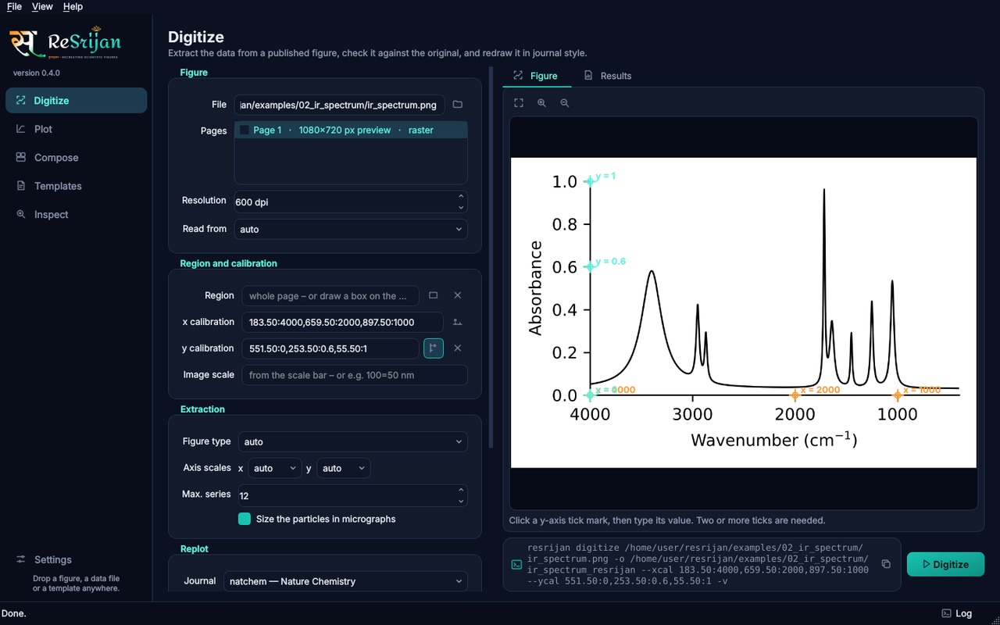
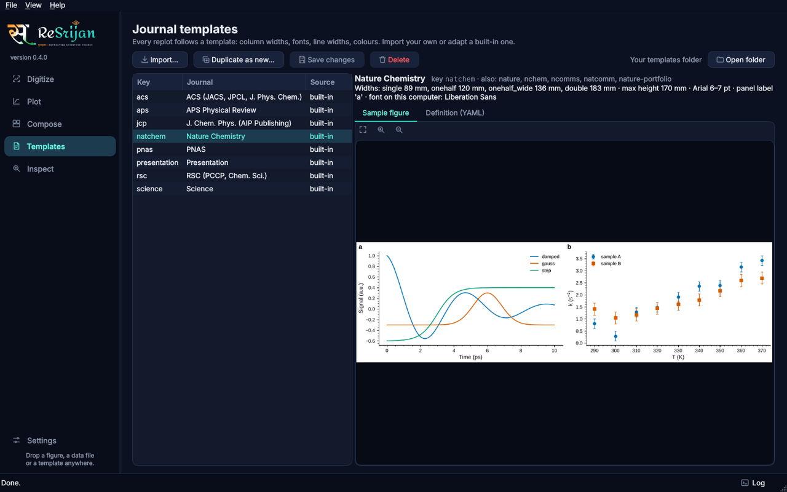
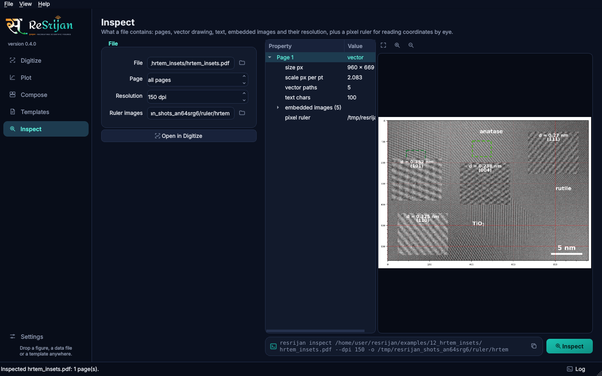

# 18 · The graphical interface

Everything in the previous tutorials can also be done in a window. The GUI runs the same code as the command line: each page builds a `resrijan …` command from your settings and runs it, and shows that command so you can copy it into a script.

## Install and start

```bash
pip install "resrijan[gui]"      # adds PySide6 (Qt for Python)
resrijan gui                     # or: resrijan-gui
resrijan gui figure.pdf          # open a file straight away
```

`./install.sh` from the source code installs the GUI too and adds ReSrijan to your application menu. From an existing installation you can add the menu entry under **Settings → Add to the application menu**.

Drop any file on the window and it goes to the right page:
- figures (PDF, EPS, SVG, PNG …) go to **Digitize**;
- data tables (CSV, TSV, NPZ) go to **Plot**;
- figure specs (YAML) go to **Compose**;
- journal templates (YAML with `widths_mm`) go to **Templates**.

**Ctrl+1 … Ctrl+6** switch pages, **Ctrl+O** opens a file, and **Ctrl+L** shows the log with the full console output of every run.

## Digitize


1. Choose the figure. Its pages appear as a list. Tick pages to digitize only those (none ticked means all pages); click a page to preview it.
2. Set any options you need; the defaults work for most figures. Every option of `resrijan digitize` is there:

   | box | options | command-line equivalent |
   |---|---|---|
   | Figure | resolution, read from vector/pixels | `--dpi`, `--prefer` |
   | Region and calibration | region, x/y calibration, image scale | `--region`, `--xcal`, `--ycal`, `--scale` |
   | Extraction | figure type, axis scales, max. series, particle sizing | `--type`, `--xscale`, `--yscale`, `--max-series`, `--no-particles` |
   | Replot | journal, width, formats, axis titles | `-t`, `--width`, `-f`, `--xlabel`, `--ylabel` |
   | Output | folder, strict mode | `-o`, `--strict` |

3. Press **Digitize**. The **Results** tab lists the panels with their warnings and errors. For the selected panel it shows:
   - its notes;
   - the **replot**;
   - the **overlay** of the extracted data on the original;
   - the **data** table;
   - a **combined** figure of all panels.

   **Open report** shows the HTML report in your browser.

### Region and manual calibration



- **Region** (rectangle button): drag a box around one panel on the preview. It becomes `--region` in page fractions.
- **Calibration** (x and y tick buttons): click a tick mark and type its value; click two or more ticks per axis. The GUI converts the clicks into `--xcal`/`--ycal` in the pixels the extraction uses: rendered at the chosen resolution, and measured from the corner of the region if you drew one. That is the `resrijan pick` workflow, without the terminal. **×** removes the clicked ticks.

With a region, vector files are read from their pixels, which is less exact; the page warns you. Leave the region empty on vector files: every panel is found automatically.

## Plot


Choose a data file and the columns appear. Tick the y columns to plot and pick an error column for each one; the GUI pairs `err_x` with `x` for you. Change the plot type, titles, scales, ranges and colour map, and the preview redraws as you type. **Save figure** writes the files (`resrijan plot`).

## Compose


Edit a multi-panel figure spec (tutorial 13) on the left and see the figure on the right. **Example** opens the spec from `examples/11_compose_figure`, and **Build figure** saves it (`resrijan compose`). You can override the output name and formats below the editor.

## Templates



Every journal style with a sample figure drawn in it.
- **Import…** adds a template file to your templates folder (`~/.config/resrijan/templates`). It is checked first: a file with missing entries, a bad key or settings matplotlib cannot use is rejected, with the reason.
- **Duplicate as new…** copies a built-in template under a new key. Edit its definition and **Save changes**; the sample figure redraws.
- **Delete** removes one of your templates.

New templates appear in every journal selector straight away, and on the command line (`-t mykey`).

## Inspect



`resrijan inspect` with a viewer: for each page, its size, vector paths, text and embedded images (with their resolution), and the pixel-ruler image. **Open in Digitize** sends the file on.

## Settings


These are the defaults for new files:
- journal, width and formats;
- render resolution and the maximum number of series;
- where results go: next to the figure, or all in one folder;
- whether the report opens automatically;
- preview resolution, and whether previews redraw while you edit.

Settings are stored in `~/.config/ReSrijan/`.

Back to the [tutorial index](README.md).
