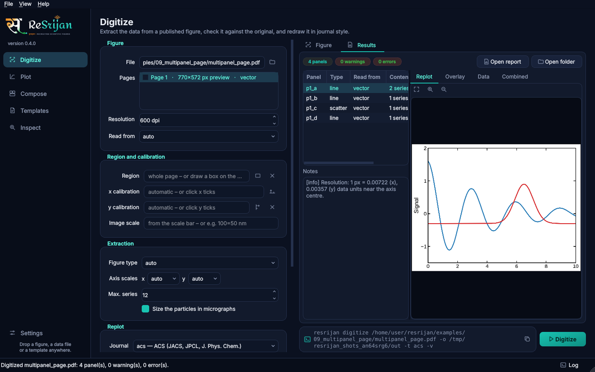
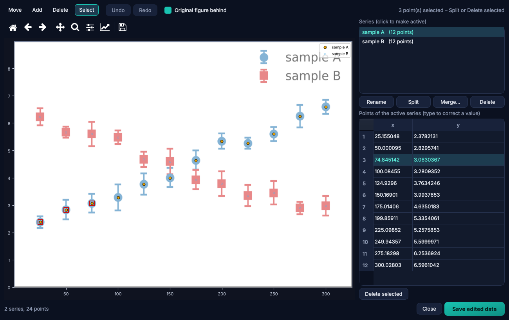
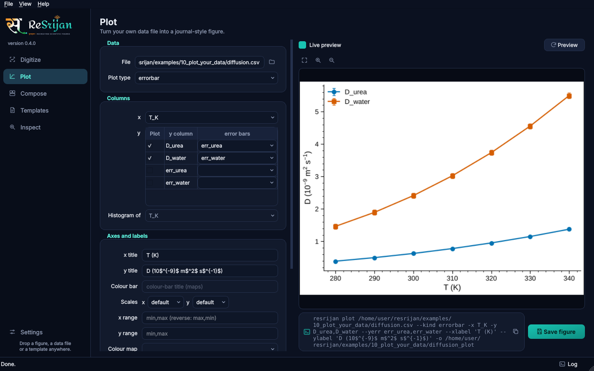
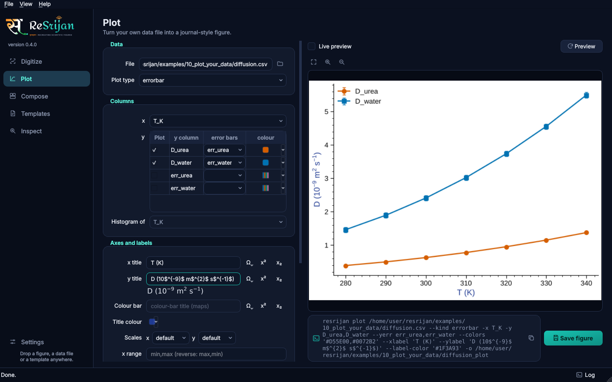
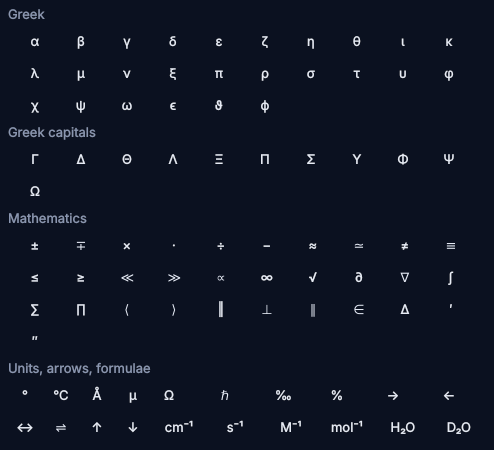
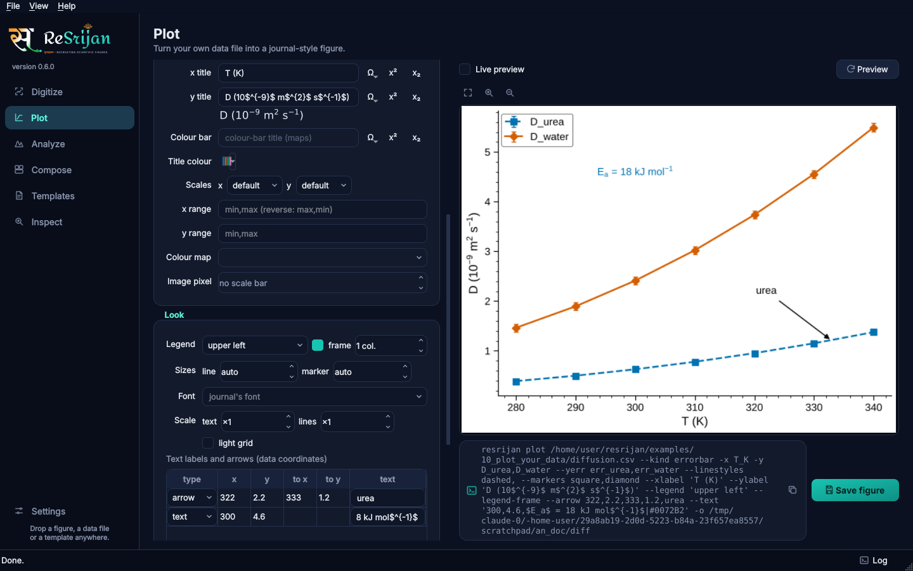
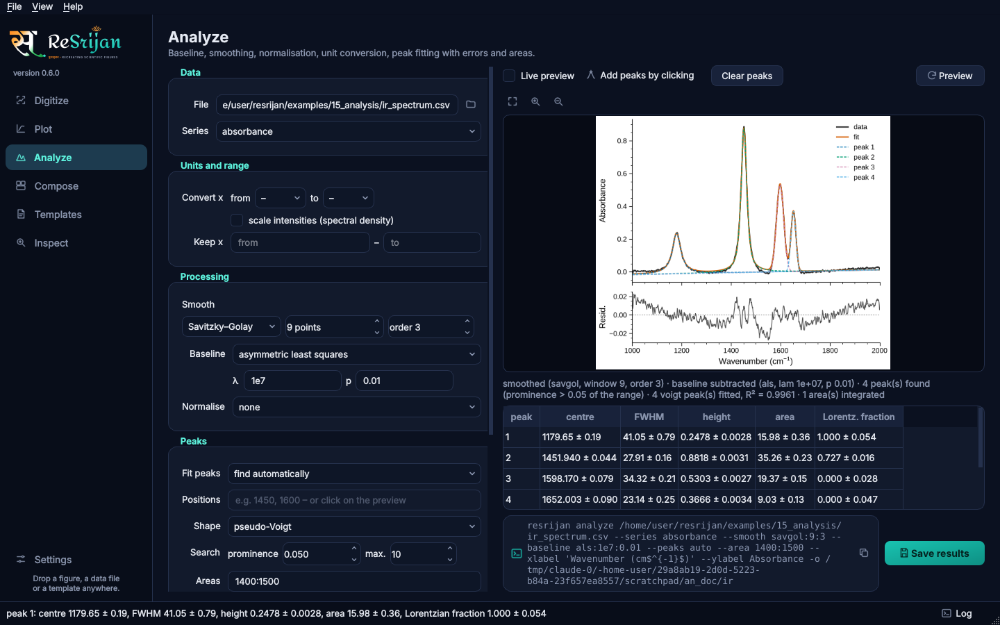
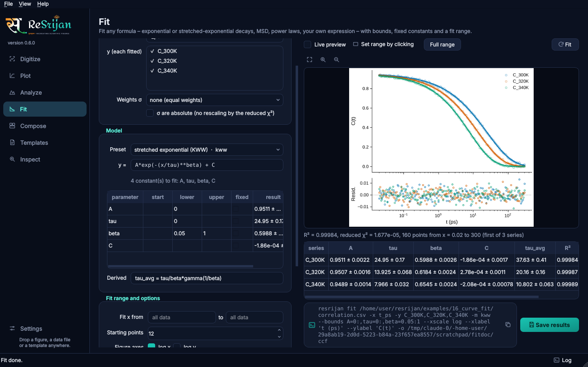
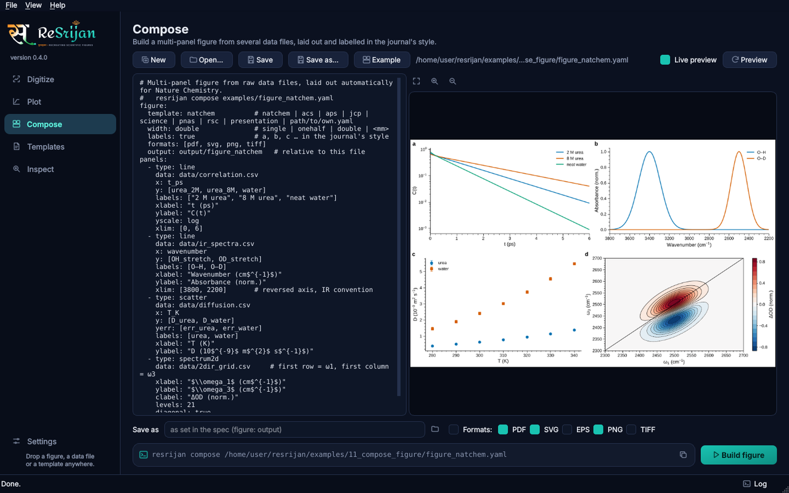
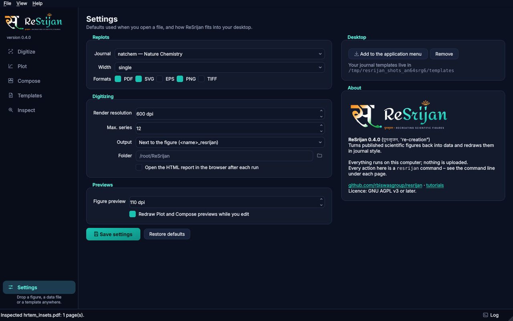

# 18 · The graphical interface

Everything in the previous tutorials can also be done in a window. The GUI runs the same code as the command line: each page builds a `resrijan …` command from your settings and runs it, and shows that command so you can copy it into a script.

## Install and start

```bash
pip install "resrijan[gui]"      # adds PySide6 (Qt for Python)
resrijan gui                     # or: resrijan-gui
resrijan gui figure.pdf          # open a file straight away
```

`./install.sh` from the source code installs the GUI too and adds ReSrijan to your application menu. From an existing installation you can add the menu entry under **Settings → Add to the application menu**.

**Windows 10/11:** run `ReSrijan-<version>-Setup.exe`. It needs no administrator rights and no other downloads. Start ReSrijan from the Start menu; **ReSrijan command prompt** opens a console where `resrijan …` works. Right-click a figure and choose **Open with → ReSrijan** to open it directly. Your templates live in `%APPDATA%\resrijan\templates`, and settings in the registry. Uninstall from **Settings → Apps** (your templates are kept).

Drop any file on the window and it goes to the right page:
- figures (PDF, EPS, SVG, PNG …) go to **Digitize**;
- data tables (CSV, TSV, NPZ) go to **Plot**;
- figure specs (YAML) go to **Compose**;
- journal templates (YAML with `widths_mm`) go to **Templates**.

**Ctrl+1 … Ctrl+6** switch pages, **Ctrl+O** opens a file, and **Ctrl+L** shows the log with the full console output of every run.

## Digitize



1. Choose the figure. Its pages appear as a list. Tick pages to digitize only those (none ticked means all pages); click a page to preview it.
2. Set any options you need; the defaults work for most figures. Every option of `resrijan digitize` is there:

   | box | options | command-line equivalent |
   |---|---|---|
   | Figure | resolution, read from vector/pixels | `--dpi`, `--prefer` |
   | Region and calibration | region, x/y calibration, image scale | `--region`, `--xcal`, `--ycal`, `--scale` |
   | Extraction | figure type, axis scales, max. series, particle sizing | `--type`, `--xscale`, `--yscale`, `--max-series`, `--no-particles` |
   | Replot | journal, width, formats, axis titles, title colour | `-t`, `--width`, `-f`, `--xlabel`, `--ylabel`, `--label-color` |
   | Output | folder, strict mode | `-o`, `--strict` |

3. Press **Digitize**. The **Results** tab lists the panels with their warnings and errors. For the selected panel it shows:
   - its notes;
   - the **replot**;
   - the **overlay** of the extracted data on the original;
   - the **data** table;
   - a **combined** figure of all panels.

   **Open report** shows the HTML report in your browser.

### Region and manual calibration


- **Region** (rectangle button): drag a box around one panel on the preview. It becomes `--region` in page fractions.
- **Calibration** (x and y tick buttons): click a tick mark and type its value; click two or more ticks per axis. The GUI converts the clicks into `--xcal`/`--ycal` in the pixels the extraction uses: rendered at the chosen resolution, and measured from the corner of the region if you drew one. That is the `resrijan pick` workflow, without the terminal. **×** removes the clicked ticks.

With a region, vector files are read from their pixels, which is less exact; the page warns you. Leave the region empty on vector files: every panel is found automatically.

### Correcting the data



Select a line or scatter panel in the results and press **Edit data…**. The extracted points are drawn over the original plot, so misread points stand out. The tools:

| tool | what it does |
|---|---|
| **Move** | drag a point (any series; the one you grab becomes active) |
| **Add** | click to add a point to the active series (kept in x order for lines) |
| **Delete** | click a point, or drag a box to delete every point of the active series inside |
| **Select** | drag a box to select points; then **Split** (they become a new series) or **Delete selected** |

The list on the right switches the active series and can **Rename**, **Merge…** (two series into one) and **Delete** series. The table lists the active series' points: type a value to correct it, or select rows to select points. **Undo**/**Redo** (Ctrl+Z / Ctrl+Shift+Z) cover every change; the matplotlib toolbar zooms and pans.

**Save edited data** writes, next to the original data:
- `<panel>_data_edited.csv` – same columns as `_data.csv`, so `resrijan plot` and `resrijan analyze` read it directly;
- `<panel>_data_edited_edits.json` – the list of changes, and the background used;
- `<panel>_replot_edited.*` – the replot with the panel's original style.

The original `_data.csv` is never changed. Reopening the editor continues from the edited file. **File → Edit data file…** (Ctrl+E) opens the editor for any data table, without a background.

## Plot



Choose a data file and the columns appear. Tick the y columns to plot and pick an error column for each one; the GUI pairs `err_x` with `x` for you. Change the plot type, titles, scales, ranges and colour map, and the preview redraws as you type. **Save figure** writes the files (`resrijan plot`).

## Titles: symbols, super- and subscripts, colours



Every title box (axis titles in Digitize and Plot, the colour-bar title in Plot) has three buttons:

- **Ω** opens a palette of Greek letters, mathematical symbols, units, arrows and common formulae (cm⁻¹, mol⁻¹, H₂O …). Click one to insert it at the cursor.
- **x²** and **x₂** turn the selected text into a superscript or subscript (`$^{…}$`, `$_{…}$`). With nothing selected they insert an empty one with the cursor inside.

Below the box, a preview shows the title as it will be printed. If a formula cannot be drawn (an unmatched `$` or brace), the preview says so in place of the title.



Colours:

- In Plot, each y column has a **colour** button: choose one of the colour-blind-safe presets or any colour; *automatic* keeps the journal's palette (`--colors`).
- **Title colour** colours the axis titles, in Plot and in Digitize (`--label-color`). Digitize otherwise keeps the colour read from the figure.
- In Compose, the toolbar has the same symbol and script buttons, and a colour button that inserts the colour's code into the spec.

### Look: legend, lines, fonts and labels



The series table has a **line** and a **marker** column for each series. The **Look** box sets:
- the legend's position (also outside the plot), frame and columns;
- line width and marker size;
- the font family and the text and line scale;
- a light grid;
- **text labels and arrows**: add a row, then type its position in data units (an arrow goes from x, y to "to x", "to y"; its text sits at the tail). The Ω, x² and x₂ buttons work on the text you clicked last.

These are the `plot` options of [tutorial 12](12-plot-your-data.md#line-styles-markers-legend-fonts-and-labels).

## Analyze



Open a data table (your own, or a digitised `*_data.csv`) and choose the series. Then set, from top to bottom:
- unit conversion and an x range;
- smoothing, baseline (with its λ and p, or the polynomial order) and normalisation;
- peaks: found automatically, or at positions you type – or switch on **Add peaks by clicking** and click each peak in the preview;
- areas to integrate.

The preview shows the fit, each peak and the residuals; below it, the steps applied and a table of the fitted peaks with standard errors (hover over it for R²). **Save results** writes the processed data, the peak table, a JSON summary and the figure (`resrijan analyze`). See [tutorial 19](19-analysis.md).

For merged bands, choose **find maxima and shoulders** or **deconvolve into N components**. You can also set the fit range, how far each centre may move and the width limits. The table then gives each component's share of the area in percent (tutorial 19, *Deconvolution*).

## Fit



Fit any formula to one or more series – correlation functions, MSD, Arrhenius plots, binding curves:
1. Open the data, pick x and tick the y series (each is fitted separately), and optionally a column of uncertainties as weights.
2. Choose a preset (single, double or triple exponential, stretched exponential, MSD in 1–3 dimensions, power law, Arrhenius, Gaussian, …) or type your own formula after **y =**. The table lists every constant: type a **start** value, **lower** and **upper** bounds, or tick **fixed**.
3. Fit all the data, or set a range: type it, or press **Set range by clicking** and click its start and end on the preview.
4. **Derived** quantities (e.g. `tau_avg = tau/beta*gamma(1/beta)`) are computed with propagated errors.

Press **Fit** (or tick *Live preview*): the results appear next to each constant, and for several series in the table below the preview. A constant stopped by a bound is flagged. **Save results** writes the parameter table, the fitted curves, a JSON file and the figure (`resrijan fit`, [tutorial 20](20-curve-fitting.md)).

## Projects

**File → Save project** (Ctrl+S) writes a `.resrijan` file with the state of every page: the figure, pages, region and clicked ticks, all options, the Plot page's columns and look, the analysis settings and the Compose spec. **File → Open project** (Ctrl+Shift+O, or drop the file on the window) restores it.

Paths inside the project folder are stored relative to the project, so the project and its data can be moved together. Results are not stored: press **Digitize** again after opening (it takes seconds), and edited data are picked up from the `_data_edited.csv` files.

## Compose



Edit a multi-panel figure spec (tutorial 13) on the left and see the figure on the right. **Example** opens the spec from `examples/11_compose_figure`, and **Build figure** saves it (`resrijan compose`). You can override the output name and formats below the editor.

## Templates


Every journal style with a sample figure drawn in it.
- **Import…** adds a template file to your templates folder (`~/.config/resrijan/templates`). It is checked first: a file with missing entries, a bad key or settings matplotlib cannot use is rejected, with the reason.
- **Duplicate as new…** copies a built-in template under a new key. Edit its definition and **Save changes**; the sample figure redraws.
- **Delete** removes one of your templates.

New templates appear in every journal selector straight away, and on the command line (`-t mykey`).

## Inspect


`resrijan inspect` with a viewer: for each page, its size, vector paths, text and embedded images (with their resolution), and the pixel-ruler image. **Open in Digitize** sends the file on.

## Settings



These are the defaults for new files:
- journal, width and formats;
- render resolution and the maximum number of series;
- where results go: next to the figure, or all in one folder;
- whether the report opens automatically;
- preview resolution, and whether previews redraw while you edit.

Settings are stored in `~/.config/ReSrijan/`.

Back to the [tutorial index](README.md).
