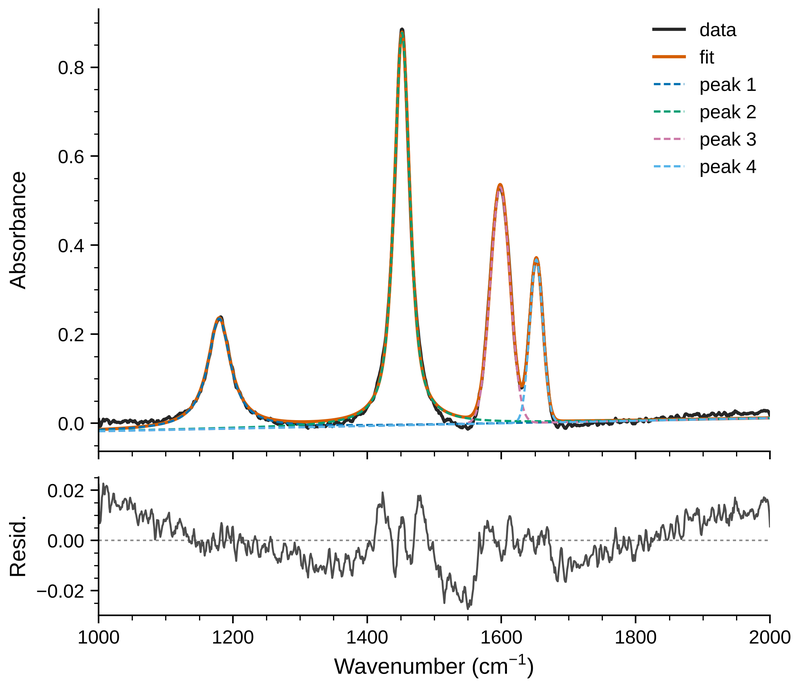
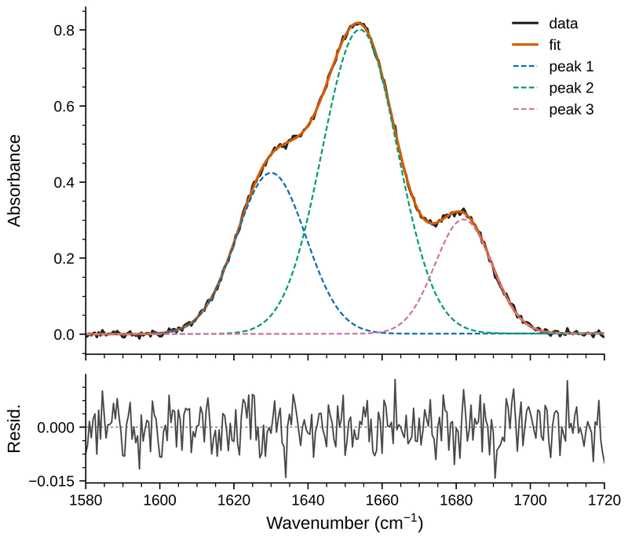

# 19 · Analyse spectra and curves

`resrijan analyze` processes one-dimensional data – your own measurements or data digitised with ReSrijan – and fits peaks with error estimates. The steps run in this order, and each one is optional:

1. **convert** the x unit (`--convert nm:eV`, among nm, µm, cm⁻¹, eV and THz);
2. **crop** to an x range (`--crop 1300:1800`);
3. **smooth** (`--smooth savgol:11:3`, Savitzky–Golay window and order, or `mean:7`);
4. subtract a **baseline** (`--baseline als:1e6:0.01`, `poly:2` or `ends`);
5. **normalise** (`--normalize max`, `area` or `minmax`);
6. find and fit **peaks** (`--peaks auto`, or positions such as `--peaks 1450,1600`), with `--shape voigt` (pseudo-Voigt, default), `gauss` or `lorentz`;
7. integrate **areas** (`--area 1400:1500,1550:1700`).

The example is a simulated IR spectrum with a sloping, slightly curved background, four bands and noise: [`examples/15_analysis/ir_spectrum.csv`](../../examples/15_analysis/ir_spectrum.csv).

```bash
cd examples/15_analysis
resrijan analyze ir_spectrum.csv --smooth savgol:9:3 --baseline als:1e7:0.01 --peaks auto \
    --area 1400:1500 --xlabel 'Wavenumber (cm$^{-1}$)' --ylabel Absorbance -o output/ir
```

```
absorbance: smoothed (savgol, window 9, order 3); baseline subtracted (als, lam 1e+07, p 0.01); 4 peak(s) found (prominence > 0.05 of the range); 4 voigt peak(s) fitted, R² = 0.9961; 1 area(s) integrated
  peak 1: centre 1179.65 ± 0.19, FWHM 41.05 ± 0.79, height 0.2478 ± 0.0028, area 15.98 ± 0.36, Lorentzian fraction 1.000 ± 0.054
  peak 2: centre 1451.940 ± 0.044, FWHM 27.91 ± 0.16, height 0.8818 ± 0.0031, area 35.26 ± 0.23, Lorentzian fraction 0.727 ± 0.016
  peak 3: centre 1598.170 ± 0.079, FWHM 34.32 ± 0.21, height 0.5303 ± 0.0027, area 19.37 ± 0.15, Lorentzian fraction 0.000 ± 0.028
  peak 4: centre 1652.003 ± 0.090, FWHM 23.14 ± 0.25, height 0.3666 ± 0.0034, area 9.03 ± 0.13, Lorentzian fraction 0.000 ± 0.047
  area 1400–1500: 30.417
```



The figure uses the journal template (`-t`, `--width`) and shows the data, the fit, each peak (dashed) and the residuals on a shared x axis.

How close is it? The spectrum was made with these bands:

| band | true centre | fitted | true FWHM | fitted | true shape | fitted Lorentzian fraction |
|---|---|---|---|---|---|---|
| 1 | 1180 | 1179.65 ± 0.19 | 40 | 41.05 ± 0.79 | Lorentzian | 1.00 ± 0.05 |
| 2 | 1452 | 1451.94 ± 0.04 | 28 | 27.91 ± 0.16 | Lorentzian | 0.73 ± 0.02 |
| 3 | 1598 | 1598.17 ± 0.08 | 36 | 34.32 ± 0.21 | Gaussian | 0.00 ± 0.03 |
| 4 | 1652 | 1652.00 ± 0.09 | 24 | 23.14 ± 0.25 | Gaussian | 0.00 ± 0.05 |

Centres are within a few error bars. Heights come out about 4 % low and the second band looks partly Gaussian: smoothing narrows sharp bands slightly, and the ALS baseline runs a little under the noise. Use less smoothing (or none) for quantitative widths and heights.

## Deconvolution of overlapping bands

Merged bands – an amide I band, overlapping vibronic bands, a shoulder on a peak – are split into components with `--components N` or `--peaks shoulders`. Hidden bands rarely give a maximum of their own, but each one gives a minimum in the (smoothed) second derivative; ReSrijan starts the components there and fits them all together.

[`amide_band.csv`](../../examples/15_analysis/amide_band.csv) is a simulated amide I band made of three Gaussians (centres 1630, 1654, 1682 cm⁻¹; FWHM 22, 24, 18; heights 0.42, 0.80, 0.30):

```bash
resrijan analyze amide_band.csv --baseline ends --components 3 --shape gauss --fwhm-range 5:40 \
    --xlabel 'Wavenumber (cm$^{-1}$)' --ylabel Absorbance -o output/amide
```

```
absorbance: baseline subtracted (ends); 4 peaks and shoulders (second derivative) found; 3 component(s) placed; 3 gauss peak(s) fitted, R² = 0.9996
  peak 1: centre 1630.05 ± 0.12, FWHM 21.98 ± 0.18, height 0.4236 ± 0.0028, area 9.91 ± 0.11 (27.52 ± 0.29 %)
  peak 2: centre 1653.998 ± 0.058, FWHM 23.87 ± 0.16, height 0.8000 ± 0.0016, area 20.33 ± 0.14 (56.45 ± 0.40 %)
  peak 3: centre 1681.937 ± 0.065, FWHM 18.07 ± 0.15, height 0.3002 ± 0.0015, area 5.774 ± 0.055 (16.03 ± 0.15 %)
```



Each component's share of the total area (with its error) is given in percent – the usual way to report secondary-structure fractions.

| option | effect |
|---|---|
| `--peaks shoulders` | start a component at every maximum *and* shoulder (second-derivative minima) |
| `--components N` | exactly N components: the strongest second-derivative minima, plus the middle of the widest gaps if fewer are found |
| `--peaks 1630,1654,1682` | start positions you know (e.g. from literature) |
| `--fit-range LO:HI` | fit only this part (the rest of the spectrum is kept and drawn) |
| `--center-window W` | each centre may move at most W from its start |
| `--fwhm-range LO:HI` | limits for every width |
| `--shape` | `gauss`, `lorentz` or `voigt` (pseudo-Voigt: the Lorentzian fraction is fitted per component) |

Deconvolution is only as good as the model: choose the number of components from the second derivative (or prior knowledge), keep widths physically sensible with `--fwhm-range`, and check that the residuals show no structure.

## Output files

| file | content |
|---|---|
| `ir_processed.csv` | `x`, `y_raw`, `baseline`, `y` (processed), `fit`, `peak1`…, `residual` |
| `ir_peaks.csv` | centre, height, FWHM, area, Lorentzian fraction, each with its standard error |
| `ir_analysis.json` | every step, the fit quality (R², RMS residual), the background line and the areas |
| `ir_analysis.pdf/.svg/.png` | the figure |

## Notes on each step

- **Errors** are one standard deviation from the fit's covariance matrix, scaled by the residual noise. Area errors combine the height and width errors.
- **Peak shapes.** The pseudo-Voigt mixes a Lorentzian and a Gaussian of the same width; its *Lorentzian fraction* (η) is fitted for each peak. Choose `gauss` or `lorentz` when you know the line shape.
- **Background.** A straight background line is always fitted along with the peaks; it absorbs small offsets left by the baseline step.
- **Baseline.** `als` (asymmetric least squares) follows curved backgrounds: λ (1e3–1e9) sets how stiff it is, p (0.001–0.1) how far it stays under the peaks. `poly:N` fits a polynomial under the signal; `ends` draws a line through the first and last 5 % of the points.
- **Automatic peaks** are found by prominence: `--prominence 0.05` keeps peaks that rise at least 5 % of the data range above their surroundings; `--max-peaks` caps the number.
- **Unit conversion** uses photon energy (E = hc/λ). Wavelength ↔ energy conversions reverse the axis order, which ReSrijan sorts out. Add `--jacobian` to scale the intensities by |dλ/dE| when the data are spectral densities.

## Digitised data

Data files written by `resrijan digitize` (`*_data.csv`) hold several series; pick one with `--series`, or analyse them all (one set of files per series in the output folder):

```bash
resrijan analyze figure_resrijan/figure_p1_a_data.csv --series "sample A" --peaks auto
```

## In the graphical interface

The **Analyze** page has every option, a live preview and a peak table with errors. Switch on **Add peaks by clicking** and click on the preview to place peaks; see [tutorial 18](18-gui.md#analyze).

## From Python

```python
from resrijan.analysis import analyze, write
an = analyze(x, y, baseline_opt=("als", {"lam": 1e6, "p": 0.01}), auto_peaks=True, shape="voigt")
for p in an.fit.peaks:
    print(p.center, p.center_err, p.fwhm, p.area)
write(an, "output/sample", template="acs")
```
