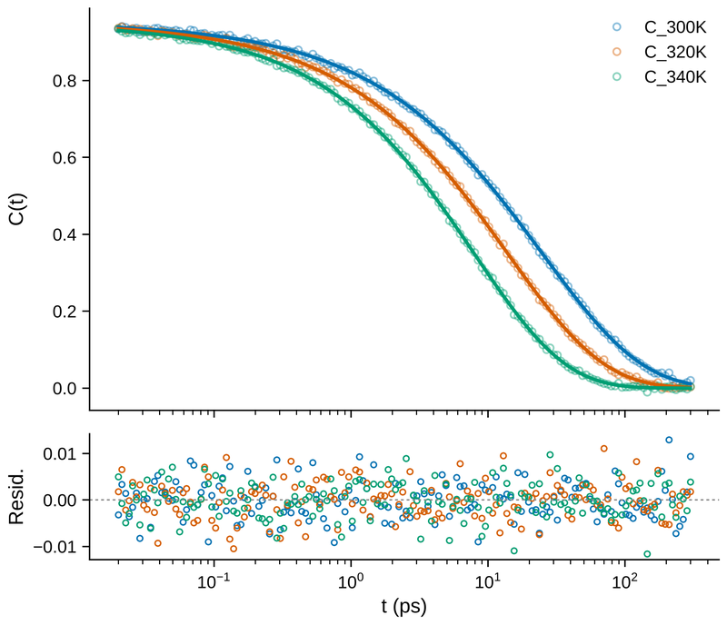
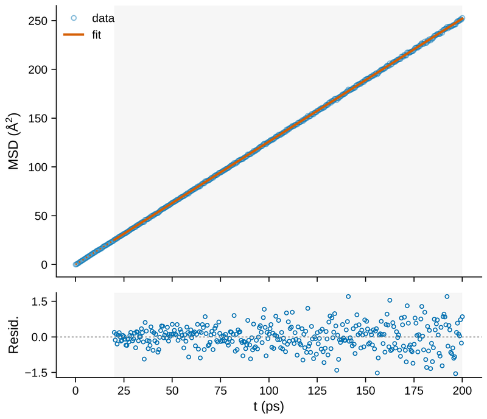

# 20 · Curve fitting: time constants, diffusion coefficients, your own models

`resrijan fit` fits any formula to one or more data series by bounded non-linear least squares. Use it to extract time constants from correlation functions, diffusion coefficients from mean square displacements (MSD), activation energies, binding constants – or anything you can write as `y = f(x)`.

- **Model**: a preset (`-m kww`) or your own formula (`-m 'A*exp(-(x/tau)**beta) + C'`). Every name other than `x`, a function or a constant is a fitted constant.
- **Starting values** (`--p0 'tau=10'`), **lower and upper bounds** (`--bounds 'tau=0:1e4,beta=0:1'`; leave a side empty for no limit, e.g. `C=:0`) and **fixed constants** (`--fix 'C=0'`).
- **Fit range**: all data, or only x in `--range LO:HI`. The figure always shows all data, with the fit range shaded and the curve continued (dotted) outside it.
- **Derived quantities** with propagated errors: `--derived 'tau_avg=tau/beta*gamma(1/beta); D_SI=D*1e-8'`.
- **Several series** (several y columns, or the series of a digitised `*_data.csv`) are fitted one by one with the same model.
- **Weights**: `--sigma COLUMN` uses y uncertainties (`--sigma errors` for the error bars of a ReSrijan data file).

## Correlation functions: τ and β

The example [`correlation.csv`](../../examples/16_curve_fit/correlation.csv) holds simulated correlation functions at three temperatures (true values τ = 25, 14, 8 ps; β = 0.60, 0.62, 0.65):

```bash
cd examples/16_curve_fit
resrijan fit correlation.csv -m kww --xscale log --xlabel 't (ps)' --ylabel 'C(t)' -o output/ccf
```

```
C_300K: A*exp(-(x/tau)**beta) + C   (x 0.02 … 300, 160 points, R² = 0.99984, reduced χ² = 1.677e-05)
  A = 0.9511 ± 0.0022
  tau = 24.95 ± 0.17
  beta = 0.5988 ± 0.0026
  C = -1.86e-04 ± 0.0017
  tau_avg = 37.63 ± 0.41  (derived)
C_320K: …  tau = 13.925 ± 0.068, beta = 0.6184 ± 0.0024, tau_avg = 20.16 ± 0.16
C_340K: …  tau = 7.966 ± 0.032,  beta = 0.6545 ± 0.0024, tau_avg = 10.802 ± 0.063
```



`tau_avg` is the mean (integral) relaxation time ⟨τ⟩ = (τ/β) Γ(1/β), added automatically by the `kww` preset. For multi-exponential decays use `exp2` or `exp3`: components are reported fastest first, and `tau_avg` = Σ Aᵢτᵢ / Σ Aᵢ.

## Mean square displacement: D

[`msd.csv`](../../examples/16_curve_fit/msd.csv) is a simulated MSD with a ballistic start (true D = 0.21 Ų/ps). Fit only the diffusive (linear) part:

```bash
resrijan fit msd.csv -m msd3d --range 20:200 --derived "D_cm2_s=D*1e-4" \
    --xlabel 't (ps)' --ylabel 'MSD (Å$^2$)' -o output/msd
```

```
msd_A2: 6*D*x + c   (x 20 … 200, 361 points, R² = 0.99994, reduced χ² = 0.2723)
  D = 0.210039 ± 0.000088
  c = -0.027 ± 0.064
  D_cm2_s = 2.10039e-05 ± 8.8e-09  (derived)
```



1 Ų/ps = 10⁻⁴ cm²/s, hence the derived `D_cm2_s`. Use `msd2d`/`msd1d` for diffusion in a plane or along a line, `msd_anomalous` (6Kt^α) for sub- or superdiffusion, and `msd_ballistic` to fit the whole curve including the ballistic start.

## Presets

```bash
resrijan fit --list-models
```

| preset | model | derived |
|---|---|---|
| `exp1`, `exp2`, `exp3` | Σ Aᵢ exp(−x/τᵢ) + C | `tau_avg` |
| `kww` | A exp(−(x/τ)^β) + C | `tau_avg` = (τ/β)Γ(1/β) |
| `exp_kww` | A₁ exp(−x/τ₁) + A₂ exp(−(x/τ₂)^β) + C | `tau2_avg`, `tau_avg` |
| `damped_cos` | A exp(−x/τ) cos(ωx + φ) + C | `period` |
| `msd3d`, `msd2d`, `msd1d` | 6Dx + c, 4Dx + c, 2Dx + c | |
| `msd_anomalous`, `msd_ballistic` | 6Kx^α; 6Dx(1 − exp(−x/τ)) | |
| `linear`, `quadratic`, `power` | ax + b; ax² + bx + c; Ax^n | |
| `arrhenius`, `vft` | A exp(−Ea/(Rx)); A exp(B/(x − T₀)) | `Ea_kJ` |
| `gaussian`, `lorentzian`, `logistic`, `hill` | peak and saturation shapes | `fwhm` |

Presets set sensible bounds (times, amplitudes and D positive; 0.05 ≤ β ≤ 1); anything you give with `--bounds` replaces them.

## Your own formula

```bash
resrijan fit correlation.csv -y C_300K -m "A*exp(-x/tau1) + B*exp(-(x/tau2)**beta)" \
    --bounds "A=0:,B=0:,tau1=0:5,tau2=1:,beta=0.1:1" -o output/custom
```

Allowed in formulas: `+ - * / **` (or `^`), numbers, `x`, the functions `exp log ln log10 log2 sqrt sin cos tan arcsin arccos arctan sinh cosh tanh abs erf erfc gamma heaviside sign min max`, and the constants `pi e kB R NA h hbar c0 kB_eV` (SI units; `kB_eV` in eV/K). Formulas are checked before use: nothing else can be run.

## Reading the results

- Errors are one standard deviation from the covariance matrix, scaled by the reduced χ² (unless `--absolute-sigma` with `--sigma`). Derived quantities carry errors propagated through the full covariance matrix, so correlations between constants are included.
- A constant that ends **at a bound** is flagged (`(at a bound!)`): the bound is limiting the fit – widen it or reconsider the model.
- The fit starts from `--starts` points (12 by default): your starting values (or guesses from the names and the data: `tau…` from the x range, `A…` from the y range, `D` from the slope) and random variations of them within the bounds; the best fit is kept.

## Output files

| file | content |
|---|---|
| `<out>_params.csv` | one row per series: every constant and derived quantity with its error, R², reduced χ², n, fit range |
| `<out>_fit.csv` | x, y, fit and residual over the fit range |
| `<out>_fit.json` | all of the above, plus the covariance matrices and flags |
| `<out>_fit.pdf/.svg/.png` | data, fits (dotted outside the fit range) and residuals |

## In the graphical interface

The **Fit** page has the same options: pick a preset or type a formula, and a table of constants appears – fill in start, lower and upper values, tick *fixed* where needed. Set the fit range by typing it or with **Set range by clicking** (click its start and end on the preview). Results appear in the table next to each constant and, for several series, in a table below the preview. See [tutorial 18](18-gui.md#fit).

## From Python

```python
from resrijan.curvefit import Param, fit
r = fit(t, msd, "6*D*x + c", [Param("D", lo=0)], x_range=(20, 200), derived={"D_cm2_s": "D*1e-4"})
print(r.values["D"], r.errors["D"], r.derived["D_cm2_s"])
```
